_Screenshots from AgIO 6.8.6._

## Main Display

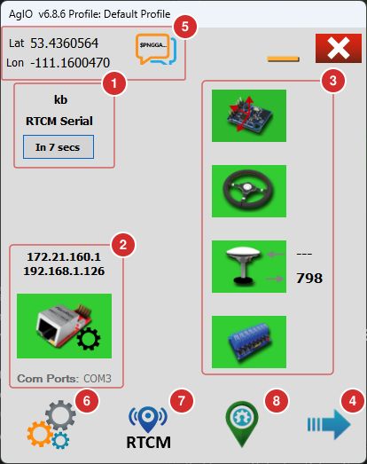

This section describes the main AgIO window and its key areas:

1. **RTK Information Area** – Displays the status of the RTK corrections:
   - The amount of correction data received in this session.
   - The status of the connection, for example 'Listening', 'Authorizing',
     'Waiting' or, for corrections from a serial port, 'RTCM Serial'.
   - A timer. While connecting, it counts down until the next connection
     attempt. Tap this outlined box to pause the RTK connection, and tap it
     again to restart it.

2. **Connections** – Displays the IP addresses of the computer's network
   connections. Tap the network icon to configure networking. If UDP is off, a
   dialog asks you to switch it on: tap **UDP Is Off** so it turns green, then
   tap OK. (Linux users: this is where you can change the loopback address.)
   Once UDP is on, the icon opens the
   [Ethernet setup dialog](#ethernet-udp-setup-dialog) instead. Below the icon,
   **Com Ports** shows a serial port found on the computer, or 'None'. It's
   updated when AgIO starts and when you open the
   [serial connections](#serial-connections) dialog.

   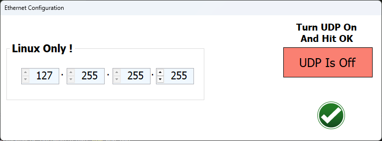

3. **Modules and Status** – Each icon represents a module: IMU, steering, GNSS
   receiver and machine. Tap an icon to open the dialog for connecting to serial
   ports.

   Icon colors indicate status:
   - **Green:** Communicating normally
   - **Red:** Lost communication after being connected
   - **No color:** Not connected this session
   - The small numbers beside the GPS icon show data bytes sent and received.

4. **Flyout Button** – Tap to expand and view the full AgIO display (see next
   section).

5. **Position Information** – Shows the current latitude and longitude. Tap the
   icon to view a dialog with all NMEA information.

6. **Settings Menu** – See [Menus](#menus) below.

7. **RTCM Menu** – Choose where the RTK corrections come from. See
   [Menus](#menus) below.

8. **AgOpenGPS** – Starts AgOpenGPS, or brings it to the front if it's already
   running.

Many settings need an AgIO profile. If you're still using the default profile,
AgIO asks you to create or choose one first (see **Profiles** under
[Menus](#menus)).

---

## Main Display (expanded view)

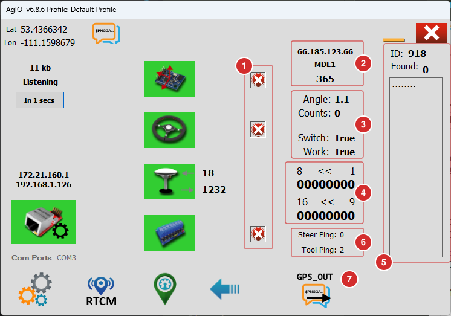

The full display provides detailed information and controls:

1. **Show/Hide Modules** – Hide unused modules by tapping 'X'. Tap '+' to
   restore them.
2. **RTK Caster IP Address and Mount** – Displays the IP address, mount, and
   packet bytes sent.
3. **Steer Module Information** – Shows steering angle, raw A/D converter
   counts, and switch status (updates once per second).
4. **Machine Module Section Status** – Displays section on/off status. If
   sections do not change to '1' when activated, check for issues.
5. **RTK Parsing** – Provides a rough estimation of station ID and sentences
   found. Note: RTK is complex; this is for reference only.
6. **Steer Ping and Tool Ping** – How long the steer module and the machine
   module took to answer, in milliseconds.
7. **GPS_OUT** – Starts GPS_Out, a separate program that sends the GNSS
   position on to other equipment.

To hide the full display, tap the blue arrow again.

---

## Ethernet (UDP) Setup Dialog

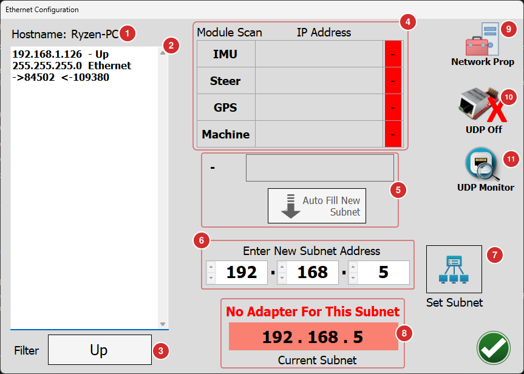

This dialog allows you to configure network adapters and subnets:

1. **Hostname** – The unique name for your computer on the network.
2. **Network Adapters List** – Shows all network adapters, their IP addresses,
   names/types, and packet statistics.
3. **Adapter Filter** – Filter to show only connected adapters ('Up') or all
   adapters ('Up + Down').
4. **Module Scan** – Lists the modules that answered, with their IP addresses
   and connection status (green = connected).
5. **Module Subnet** – The subnet the modules reported. All devices must be on
   the same subnet. Tap **Auto Fill New Subnet** to copy it into the fields
   below.
6. **Enter New Subnet Address** – Enter a new subnet manually.
7. **Set Subnet** – Sets the subnet address for AgIO and sends it to modules.
   The indicators should turn green if successful.
8. **Current Subnet** – Shows the current subnet set in AgIO. If no network
   adapter of the computer is on this subnet, AgIO warns you with 'No Adapter
   For This Subnet'.
9. **Network Prop** – Opens the network connections in the Windows Control
   Panel.
10. **UDP Off** – Switches UDP off.
11. **UDP Monitor** – Opens the [UDP Monitor](/software/udp-monitor/).

For a step-by-step guide, see [Ethernet Setup](/software/ethernet-setup/).

---

## Serial Connections

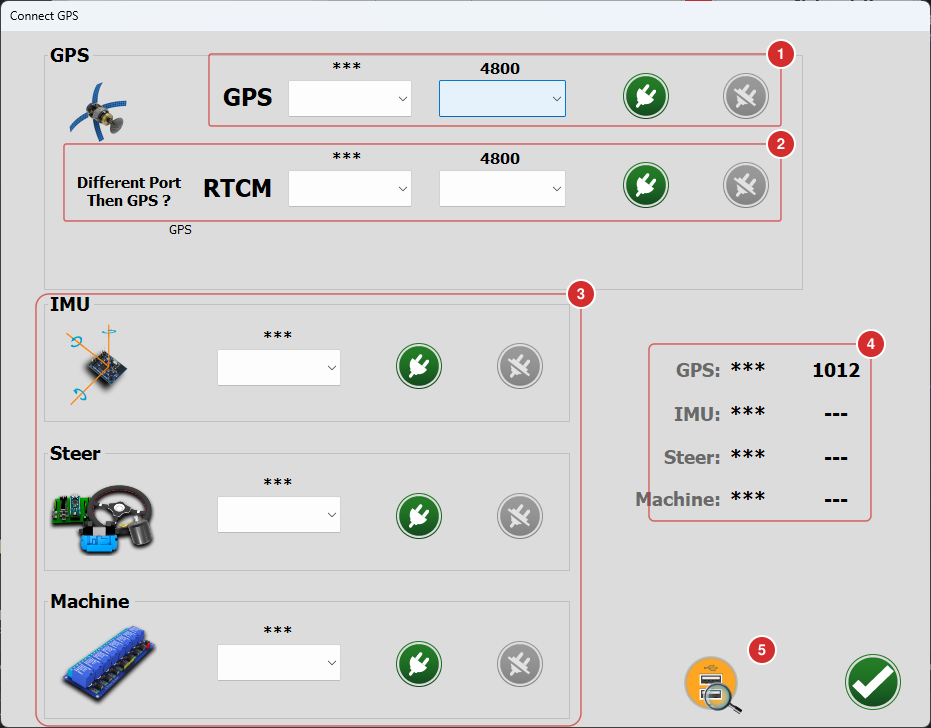

This section covers connecting serial devices:

1. **GPS** – Choose the serial COM port and baud rate of a serial GNSS receiver,
   then tap the green connect button.
2. **RTCM** – If the RTK corrections go to the receiver through a different
   port than the GPS data, connect that port here.
3. **Module Connections** – Connect the IMU, steer and machine modules here.
   Plug in one at a time to identify each, then connect.
4. **Connection Status** – Shows the port of each connection and the data it
   receives.
5. **Rescan Ports** – If you connect an additional USB COM port, tap here to add
   it to the list of available ports.

---

## RTK

This section explains the NTRIP client, which fetches RTK corrections over the
internet. Open it from the RTCM menu with **NTRIP**. For a step-by-step guide,
see [RTK Setup](/software/rtk-setup/).

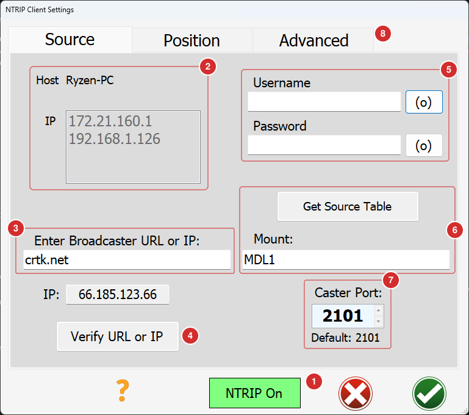

1. **NTRIP On** – Enable or disable NTRIP (Networked Transport of RTCM via
   Internet Protocol).
2. **Computer Name and Networks** – Displays your computer name and all active
   networks.
3. **Caster Address** – Enter the IP or URL of your caster.
4. **Verify URL or IP** – Tap to verify the caster is accessible. Its IP address
   is shown above the button.
5. **Caster Credentials** – Enter your caster username and password. The (o)
   buttons show what you typed.
6. **Mount** – The mount point of the base station you use. Tap **Get Source
   Table** to retrieve the list of mounts the caster offers, and select the
   appropriate one.
7. **Caster Port** – The port used by the caster (default is 2101).
8. **Advanced** – Settings you rarely need: the HTTP version, connecting over
   plain TCP, and the size of the packets AgIO sends. Leave them unchanged unless
   your caster needs something else.

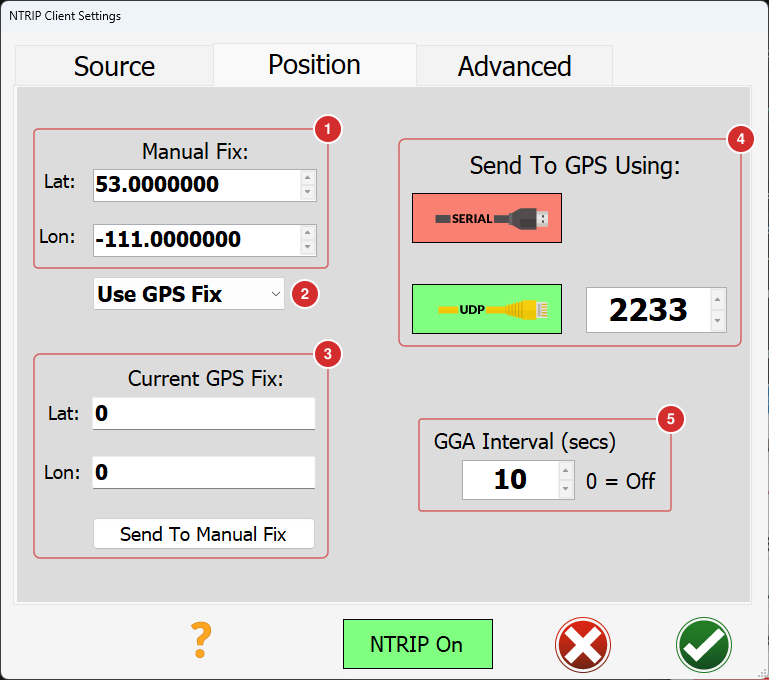

1. **Manual Fix** – A position to send to the caster when you don't want to use
   the GNSS position.
2. **Use GPS Fix / Use Manual Fix** – Choose which position AgIO sends to the
   caster.
3. **Current GPS Fix** – The current GNSS position. Tap **Send To Manual Fix** to
   copy it into the manual fix.
4. **Send To GPS Using** – Select whether to send RTK to the receiver via serial
   or UDP, and specify the UDP port. Disable unused methods.
5. **GGA Interval** – Set how often a GGA sentence is sent to the caster. More
   frequent updates use more data. Set this to 0 to disable.

---

## Menus

### Settings Menu

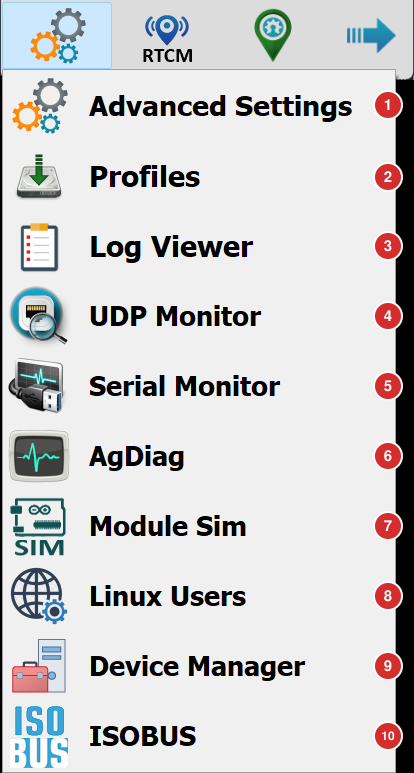

1. **Advanced Settings** – Start AgIO minimized, pop up AgIO when there's a
   warning, and start GPS_Out automatically.
2. **Profiles** – Create, open and save AgIO profiles. A profile stores all AgIO
   settings, including the RTK settings.
3. **Log Viewer** – Shows the AgIO event log.
4. **UDP Monitor** – View UDP packets sent and received by AgIO, including PGNs,
   NTRIP, and NMEA strings. See [UDP Monitor](/software/udp-monitor/).
5. **Serial Monitor** – Connect to any serial port and monitor its activity.
   See [Serial Monitor](/software/serial-monitor/).
6. **AgDiag** – Starts AgDiag, a separate diagnostics program.
7. **Module Sim** – Starts ModSim, a separate program that simulates the
   modules.
8. **Linux Users** – Opens the dialog for switching UDP on and changing the
   loopback address. Only change the loopback address if you are using Linux or
   understand the implications.
9. **Device Manager** – Opens the Windows Device Manager.
10. **ISOBUS** – Settings for ISOBUS implement control: the CAN bus adapter and
    channel. This needs the separate
    [AOG-TaskController](https://github.com/GwnDaan/AOG-TaskController).

### RTCM Menu

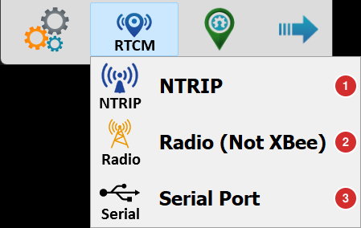

1. **NTRIP** – Corrections from the internet: caster address, mount, username,
   and password. See [RTK](#rtk) above.
2. **Radio (Not XBee)** – Corrections from a radio modem. See
   [Radio](#radio) below.
3. **Serial Port** – Corrections arriving on a serial port, e.g. from a phone
   over USB or an external radio with a serial output. See
   [Serial Port](#serial-port) below.

Only one of them can be on at a time.

### Radio

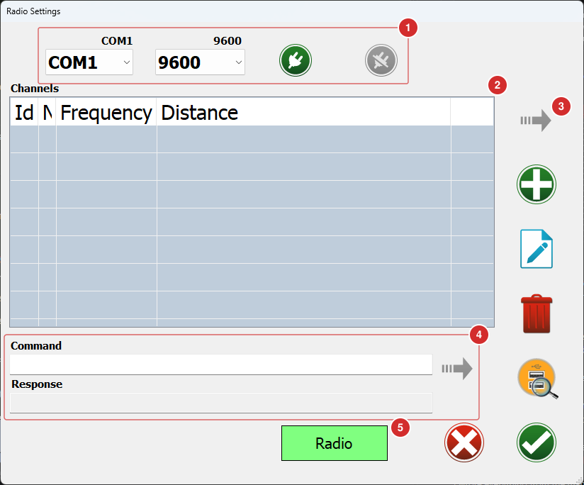

For RTK corrections from a radio modem connected to the tablet.

1. **Port and Baud** – The serial port of the radio modem and its baud rate.
   Connect and disconnect with the plug buttons next to them. The magnifying
   glass on the right scans for ports again.
2. **Channels** – Your list of radio channels, each with an ID, a name and a
   frequency. If you enter the location of a channel's base station, the list
   also shows how far away it is. Add, edit and delete channels with the buttons
   on the right.
3. **Set channel** (the arrow at the top right) – Sends the frequency of the
   selected channel to the radio modem.
4. **Command and Response** – Type any command for the radio modem, send it with
   the arrow next to it, and see its reply.
5. **Radio** – Uses the radio as the correction source. Switching it on switches
   NTRIP from the internet off.

### Serial Port

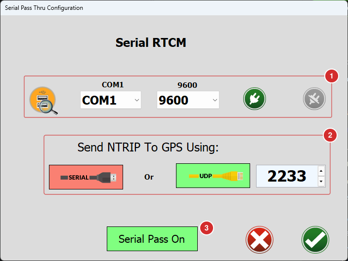

For RTK corrections that arrive on a serial port, for example from an external
radio with a serial output. AgIO passes them on to the GNSS receiver. For a
step-by-step guide, see [RTK Setup](/software/rtk-setup/).

1. **Port and Baud** – The serial port the corrections arrive on, and its baud
   rate. Connect and disconnect with the plug buttons; the magnifying glass
   scans for ports again.
2. **Send NTRIP To GPS Using** – How AgIO passes the corrections on to the
   receiver: over a serial port, or over UDP to the given port.
3. **Serial Pass On** – Switches the pass-through on. NTRIP from the internet
   and the radio have to be off first.
