The **Auto Steer Configuration** window holds the settings for steering. Open
it with the steer button on the left of the
[main screen](/software/agopengps-orientation/), or in the settings menu.

_Screenshots from AgOpenGPS 6.8.6._

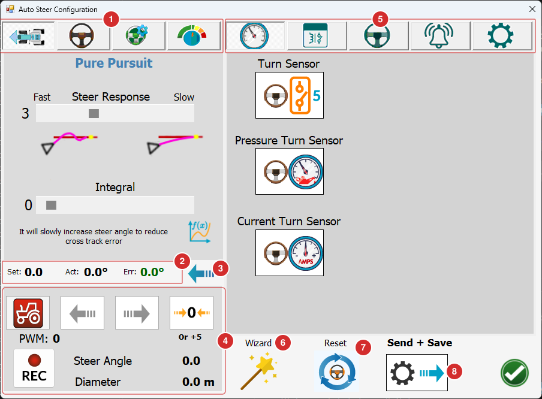

1. **Steering tabs** – [Pure Pursuit](#pure-pursuit) and
   [Pure Pursuit Advanced](#pure-pursuit-advanced), or [Stanley](#stanley);
   [Steer](#steer) and [Gain](#gain).
2. **Set**, **Act** and **Err** – The steer angle AgOpenGPS asks for, the
   actual steer angle from the wheel angle sensor, and the difference between
   them.
3. **Expand** – Shows or hides the module tabs.
4. **Drive and Test** – For testing the steering by hand:
   - The tractor button switches test driving on or off.
   - The arrows steer left and right, 1° per tap. **>0<** switches between
     straight ahead and 5°.
   - **PWM** shows how hard the motor is driven.
   - **REC** measures a circle: drive with a steady steer angle, and AgOpenGPS
     calculates the **Diameter** and the real **Steer Angle** from it.
5. **Module tabs** – Only shown when the window is expanded:
   [Sensors](#sensors), [Config](#config), [Settings](#settings),
   [Alarm](#alarm) and [On The Line](#on-the-line).
6. **Wizard** – Closes the window and starts the Steer Wizard.
7. **Reset** – Sets the steer settings back to their defaults, after asking you
   to confirm.
8. **Send + Save** – Saves the settings and sends them to the steer module.

## Steering Tabs

The first tab depends on the steering mode, which you choose under
[Settings](#settings). In Stanley mode, there is no Pure Pursuit Advanced tab.

### Pure Pursuit

Pure Pursuit steers towards a point on the line ahead of the vehicle (the look
ahead), measured from the middle of the rear axle (the pivot point).

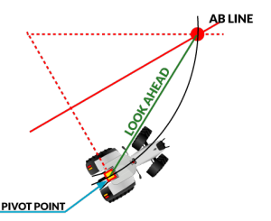

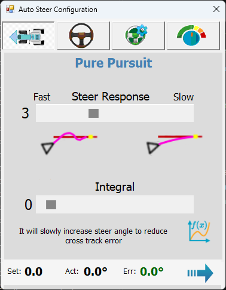

- **Steer Response** – How far ahead that point is.
- **Integral** – As the app says: it slowly increases the steer angle to reduce
  the cross-track error.

### Pure Pursuit Advanced

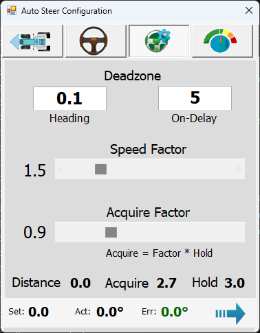

- **Deadzone** – When the actual steer angle stays within **Heading** degrees of
  the set angle for longer than **On-Delay**, AgOpenGPS stops sending new steer
  angles.
- **Speed Factor** – How much further ahead the point is at higher speed.
- **Acquire Factor** – As the app says: Acquire = Factor × Hold.
- **Distance**, **Acquire** and **Hold** – The current values.

### Stanley

Stanley looks at both the distance to the line and the heading error, measured
at the front axle.

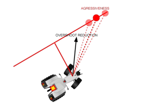

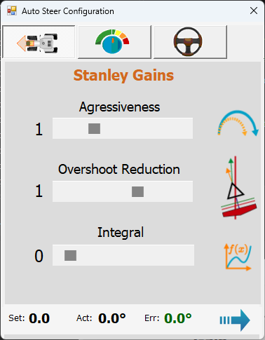

- **Agressiveness** – Works with the distance to the line. The higher, the
  faster it steers towards the line, with the risk of crossing over it.
- **Overshoot Reduction** – Works with the heading, against **Agressiveness**.
  Balance the two, so you get to the line quickly without going over it or
  swinging back and forth.
- **Integral** – Like in Pure Pursuit.

### Steer

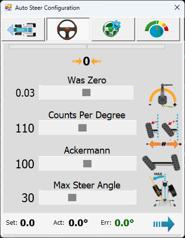

These settings set up the wheel angle sensor (WAS).

- **>0<** and **WAS Zero** – Set the steer angle to 0° while you drive straight
  ahead. This is an important setting and must be set accurately.
- **Counts Per Degree** – Converts the sensor readings into degrees. The higher
  the value, the further the wheels turn for each degree.
- **Ackermann** – Makes up for the inner and outer wheels turning on circles of
  different size.
- **Max Steer Angle** – The largest steer angle autosteer uses.

### Gain

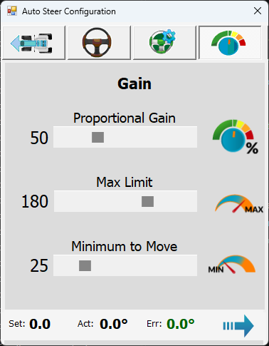

- **Proportional Gain** – The higher, the faster the motor corrects the
  steering. Too high, and the steering overshoots the line and oversteers the
  other way; too low, and it takes too long or never gets to the line.
- **Max Limit** – The most power (PWM) the motor gets.
- **Minimum to Move** – The least power the motor gets, to overcome the
  friction of the valve or motor.

## Module Tabs

### Sensors

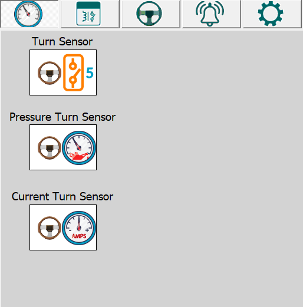

Choose the sensor that switches autosteer off when you turn the steering wheel
by hand: **Turn Sensor**, **Pressure Turn Sensor** or **Current Turn Sensor**.

After a change here, you can only close the window again after **Send + Save**.

### Config

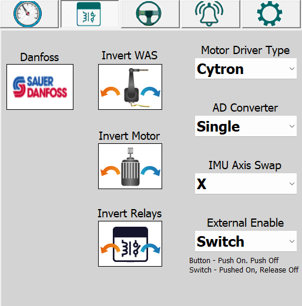

- **Danfoss** – For steering with a Danfoss valve.
- **Invert WAS**, **Invert Motor** and **Invert Relays** – Reverse the
  direction.
- **Motor Driver Type** – **Cytron** or **IBT2**.
- **AD Converter** – **Single** or **Differential**.
- **IMU Axis Swap** – **X** or **Y**.
- **External Enable** – A switch or button for autosteer: **None**,
  **Switch** (pushed on, release off) or **Button** (push on, push off).

### Settings

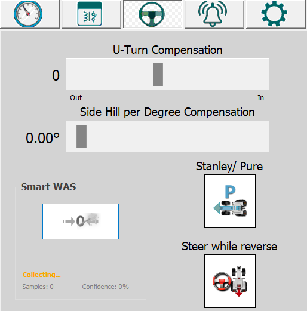

- **U-Turn Compensation** – Adjusts the steering in U-turns, from **Out** to
  **In**.
- **Side Hill per Degree Compensation** – Degrees of compensation for each
  degree of roll.
- **Smart WAS** – Collects samples while you drive and suggests a zero for the
  wheel angle sensor. Tap the **>0<** button to use it.
- **Stanley/ Pure** – Switches between Stanley and Pure Pursuit.
- **Steer while reverse** – Keeps autosteer on when reversing.

### Alarm

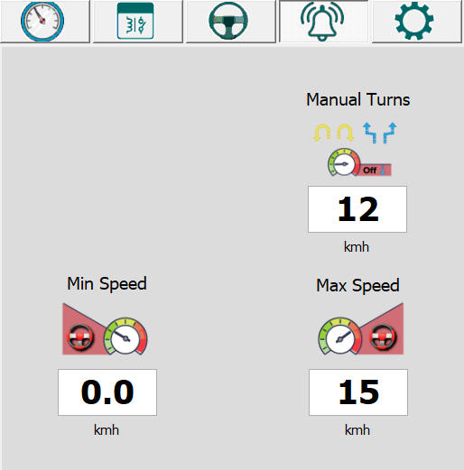

- **Manual Turns** – The manual U-turn and lateral buttons only work below this
  speed.
- **Min Speed** and **Max Speed** – Autosteer only works between these speeds.

### On The Line

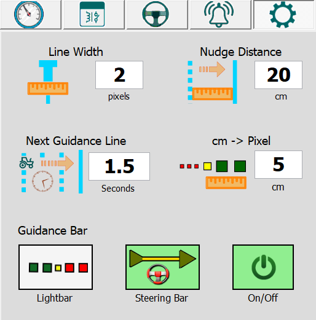

- **Line Width** – How thick the guidance line is drawn.
- **Nudge Distance** – How far the line moves with each nudge.
- **Next Guidance Line** – How many seconds ahead AgOpenGPS looks to pick up
  the next guidance line.
- **cm -> Pixel** – The distance each square of the lightbar stands for.
- **Guidance Bar** – Shows a **Lightbar** or a **Steering Bar** at the top of
  the main screen, or switches it off (**On/Off**).
