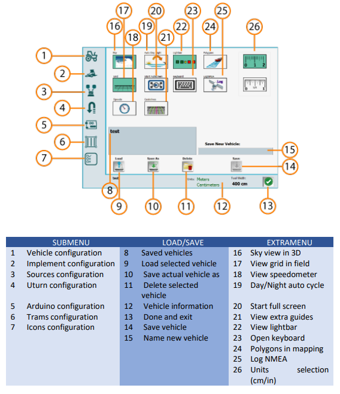

1. Vehicle Configuration

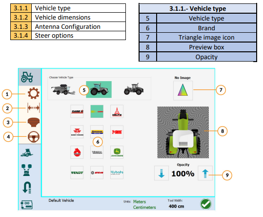

2. Vehicle Dimensions

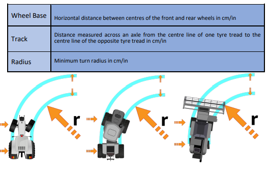

3. Antenna Configuration

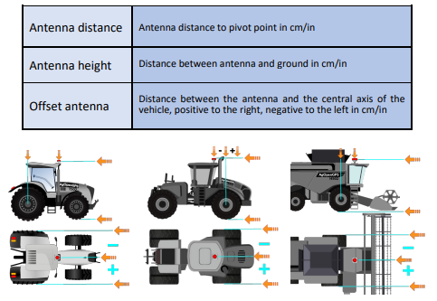

4. Steer Options

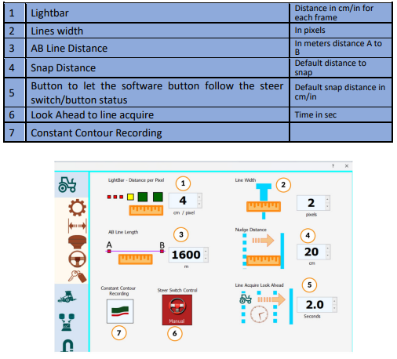

5. Implement Configuration

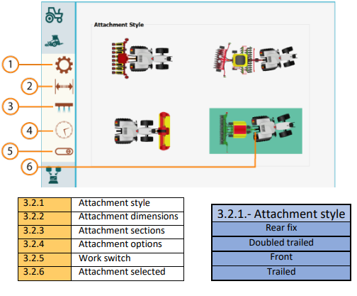

6. Attachment Configuration

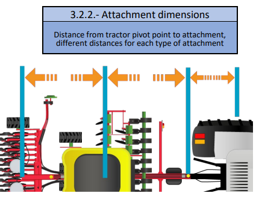

7. Sections TODO

8. Attachment Options

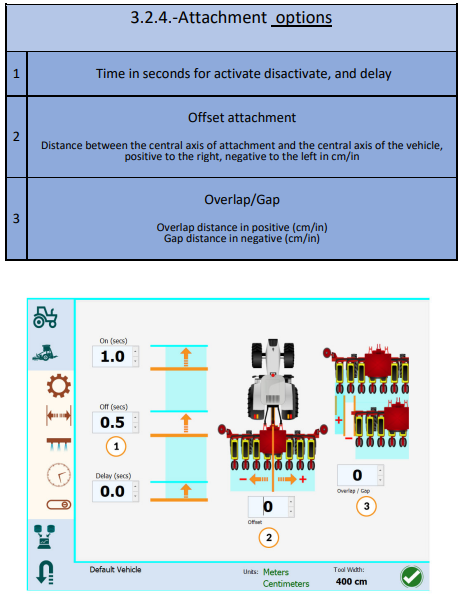

For (1), top to bottom, they are:

- Time to turn on the section early before getting to the unapplied area (for
  start of row)
- Time to shut sections off, before getting to the applied region (for end of
  row)
- Time to keep going after applied area says they should turn off

9. Work Switch Configuration

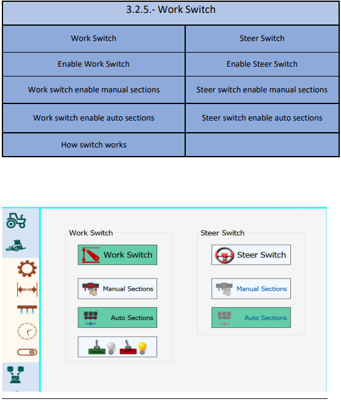

If Work switch is enabled, then choose if you'd like to have it engage manual or
auto-sections. Similar for Steer switch.

Toggle at the bottom is for if you want "work" to be counted when the work
switch is on, or off.

10. Sources Configuration TODO

11. Roll Configuration

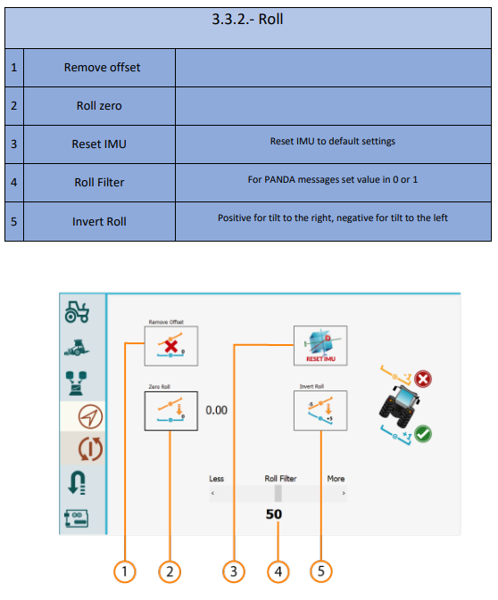

12. U-Turn Configuration

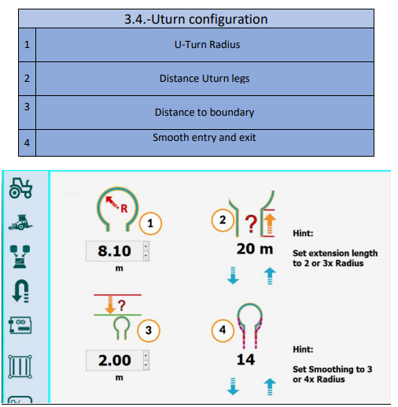

(1) the radius you can comfortably make a turn in, without binding the
machine/drawbar/tractor/PTO etc

13. Arduino Machine Module Configuration

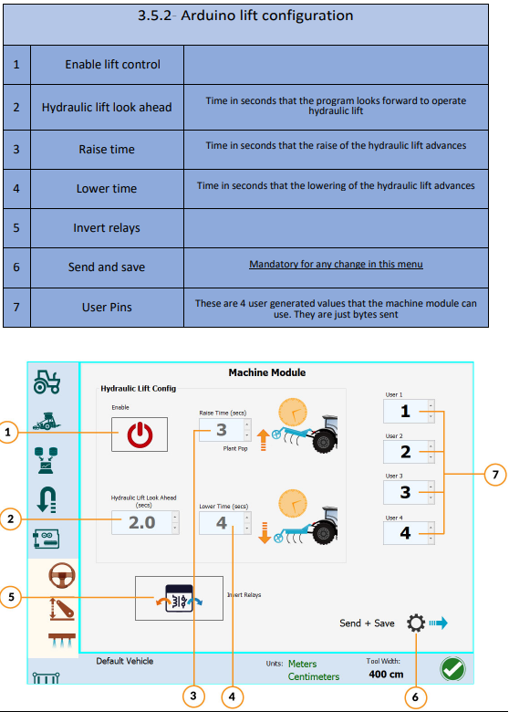

14. Pin Configuration

15 Tram Lines Configuration.

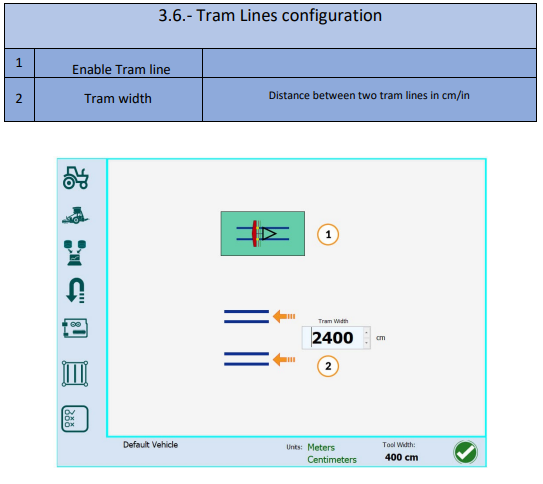

16. Icons and Sounds Configurations.

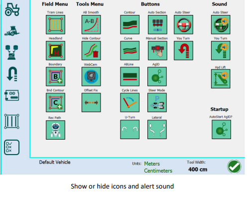
