The configuration window holds the settings for the vehicle and the tool it
carries or pulls. AgOpenGPS uses these dimensions to place the vehicle, the tool
and the guidance lines correctly, so measure them carefully.

_Screenshots from AgOpenGPS 6.8.6._

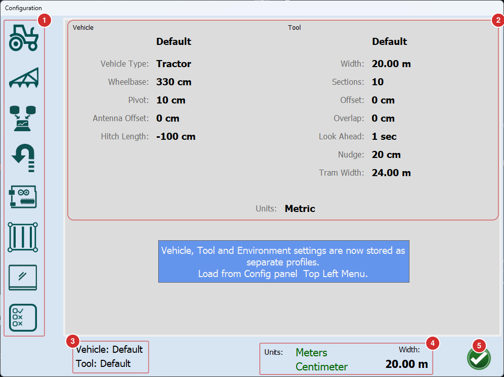

1. **Menu** – Opens the settings pages, from top to bottom:
   - [Vehicle](#vehicle) (tractor)
     - [Vehicle Type](#vehicle-type)
     - [Dimensions](#dimensions)
     - [Antenna](#antenna)
   - [Tool](#tool) (implement)
     - [Attachment Style](#attachment-style)
     - [Tool Dimensions](#tool-dimensions)
     - [Tool Pivot](#tool-pivot)
     - [Offset](#offset)
     - [Sections](#sections)
     - [Look Ahead](#look-ahead)
     - [Switches](#switches)
   - [Data Sources](#data-sources)
     - [Heading](#heading)
     - [Roll](#roll)
   - [U-Turn](#u-turn)
   - [Machine Module](#machine-module) (board)
     - [Hydraulic Lift](#hydraulic-lift)
     - [Pins](#pins)
   - [Tram Lines](#tram-lines)
   - [Display](#display) (screen)
   - [Features](#features) (check list)

   Tapping a group shows its pages below it; tapping it again closes it and
   brings back the summary.

2. **Summary** – The most important settings of the current vehicle and tool.
3. **Profiles** – The names of the vehicle and tool profiles that are loaded.
4. **Units and Width** – The units in use and the total width of the tool.
5. **OK** – Closes the window. Your changes are saved when you leave a page.

## Vehicle

### Vehicle Type

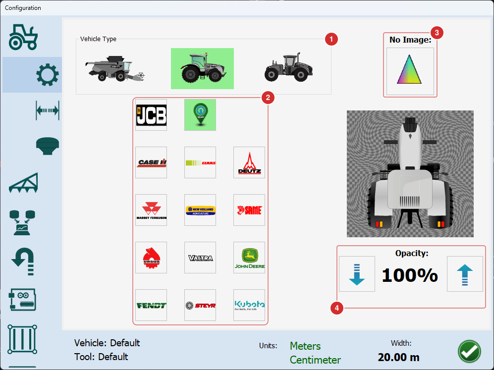

1. **Vehicle Type** – Harvester, tractor or articulated tractor. With a
   harvester, the tool is always mounted at the front.
2. **Brand** – The picture that represents the vehicle on the main screen. The
   available brands depend on the vehicle type.
3. **No Image** – Shows a simple triangle instead of a picture.
4. **Opacity** – How see-through the picture of the vehicle is.

The vehicle type also changes other pages: the pictures on the
[Dimensions](#dimensions) and [Antenna](#antenna) pages, and with a harvester,
the [Attachment Style](#attachment-style) and [Tool Dimensions](#tool-dimensions) pages. The
screenshots on this page show a tractor.

### Dimensions

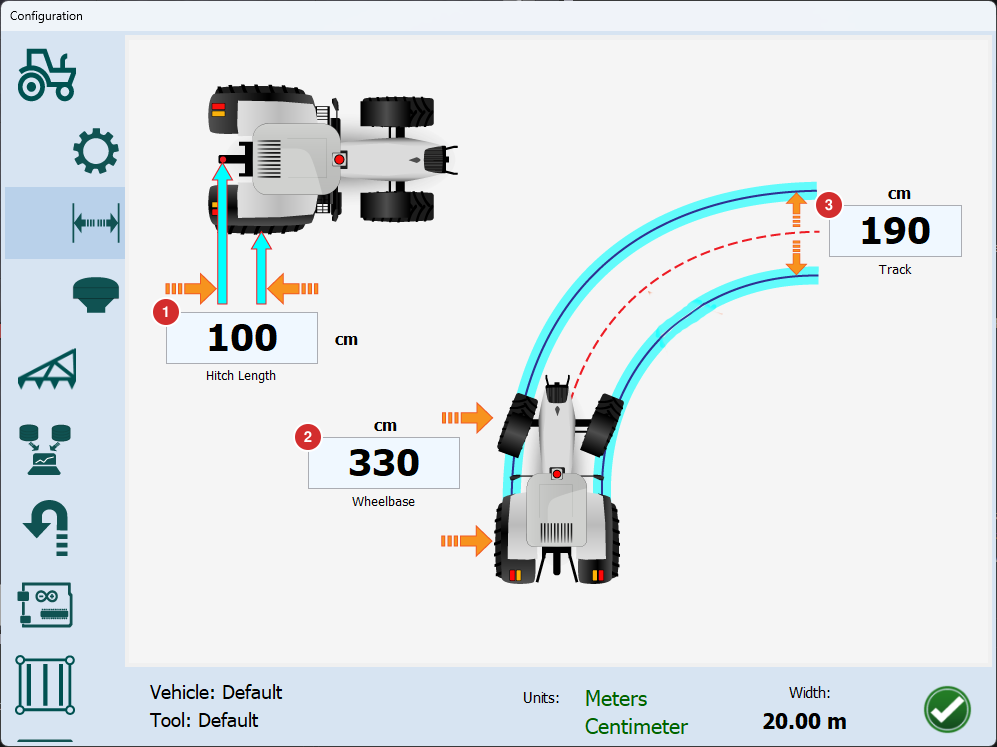

1. **Hitch Length** – The distance from the pivot axle to the hitch point. For a
   tractor, that's the rear axle; for an articulated tractor, the front axle
   (see [Antenna](#antenna)). Only shown for the
   [attachment styles](#attachment-style) **Trailing** and **Tow Between**.
2. **Wheelbase** – The distance between the front and the rear axle.
3. **Track** – The distance between the centres of the left and the right
   wheels.

### Antenna

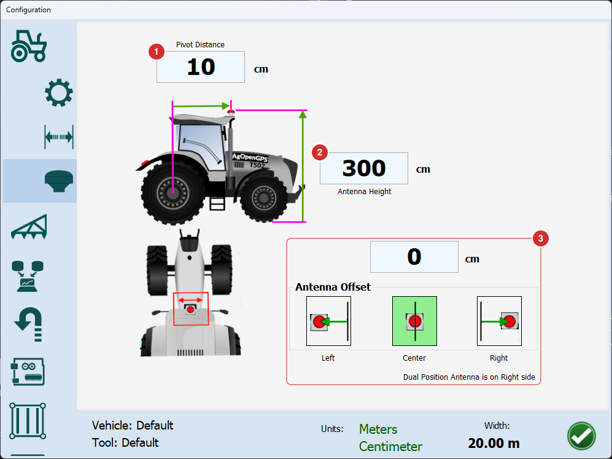

1. **Pivot Distance** – How far the antenna is in front of the pivot axle. Which
   axle that is depends on the vehicle type:
   - **Tractor:** the rear axle.
   - **Harvester:** the front axle, because a harvester steers with its rear
     wheels.
   - **Articulated:** the front axle.

   If the antenna is behind that axle, enter a negative value.

2. **Antenna Height** – The height of the antenna above the ground. It's used to
   correct the position when the vehicle tilts (see [Roll](#roll)).
3. **Antenna Offset** – How far the antenna is to the side of the centre line.
   Enter the distance, then tap **Left** or **Right**. **Center** sets it to 0.
   With two antennas, the position antenna is the one on the right side.

## Tool

### Attachment Style

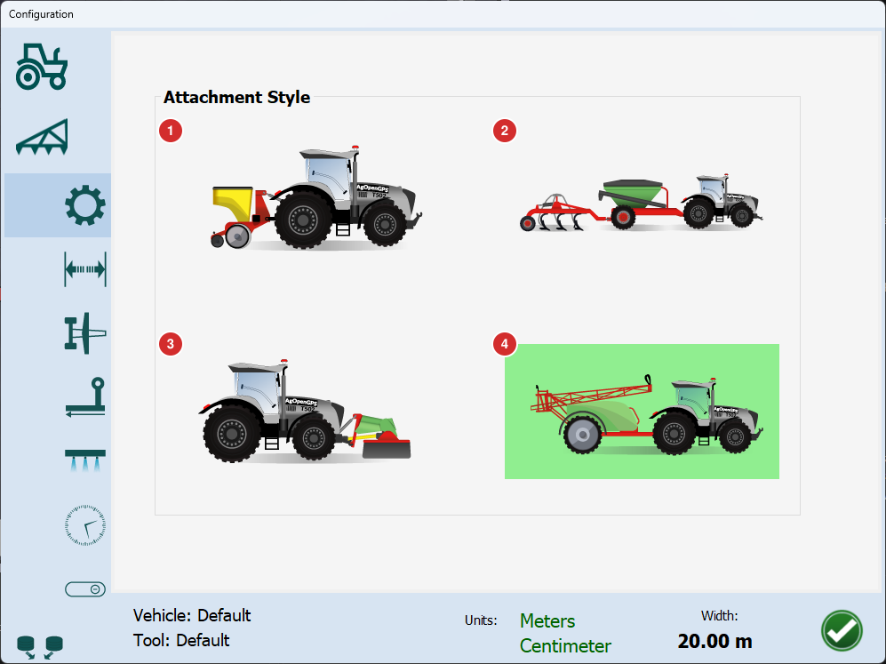

How the tool is attached to the vehicle:

1. **Rear Fixed** – Mounted on the rear three-point hitch.
2. **Tow Between** – A cart, for example the tank of an air seeder, is towed
   between the vehicle and the tool.
3. **Front** – Mounted at the front of the vehicle.
4. **Trailing** – Pulled directly by the vehicle.

With a harvester, only **Front** is available.

### Tool Dimensions

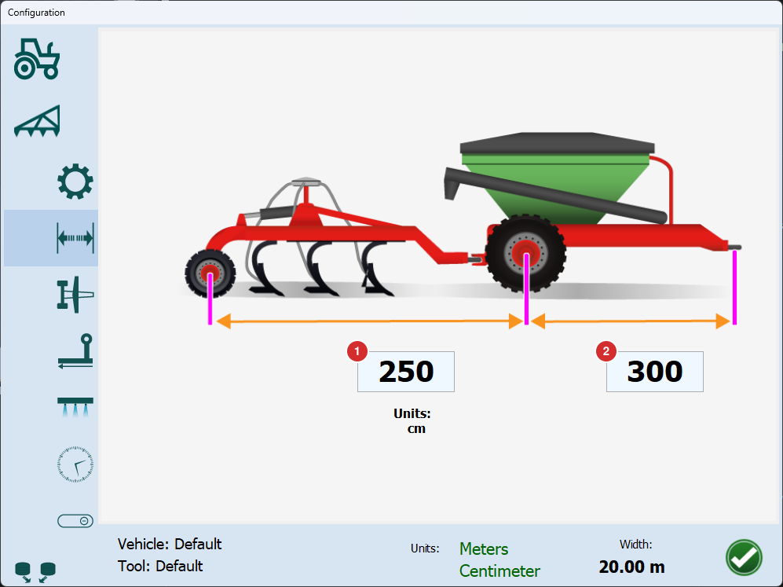

The page shows your [attachment style](#attachment-style). With
**Tow Between**, there are two lengths:

1. **Tool** – From the tool's axle to the cart's axle.
2. **Cart** – From the cart's axle to its hitch.

The other attachment styles have a single length. The arrow shows what to
measure:

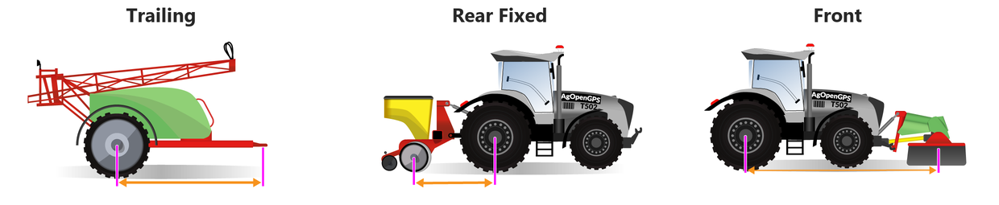

With a harvester, the length runs from the front axle to the front of the
header.

### Tool Pivot

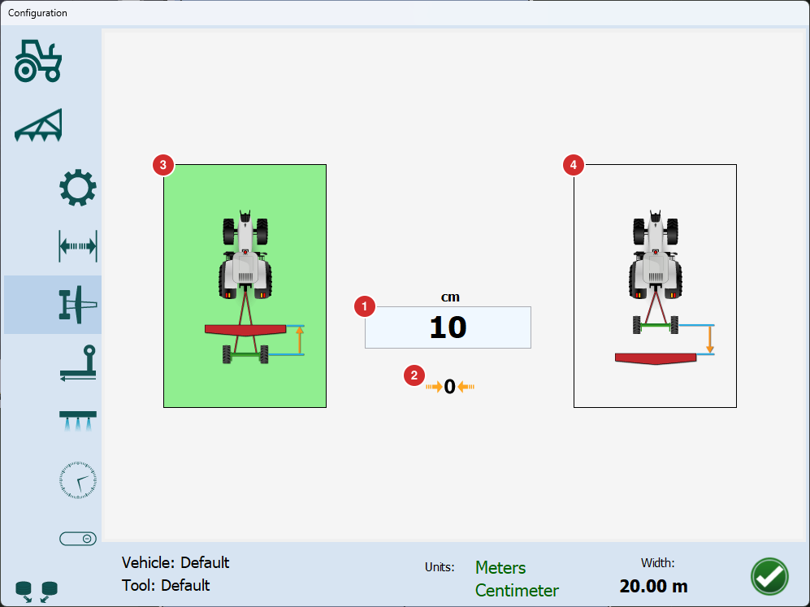

For a trailing tool: where the working part of the tool is compared to its axle.
Enter the distance, then tap one of the two pictures to choose the direction.

1. **Distance** – How far the working part is from the axle.
2. **Zero** – Sets the distance to 0.
3. **Ahead** – The tool works in front of its axle.
4. **Behind** – The tool works behind its axle.

### Offset

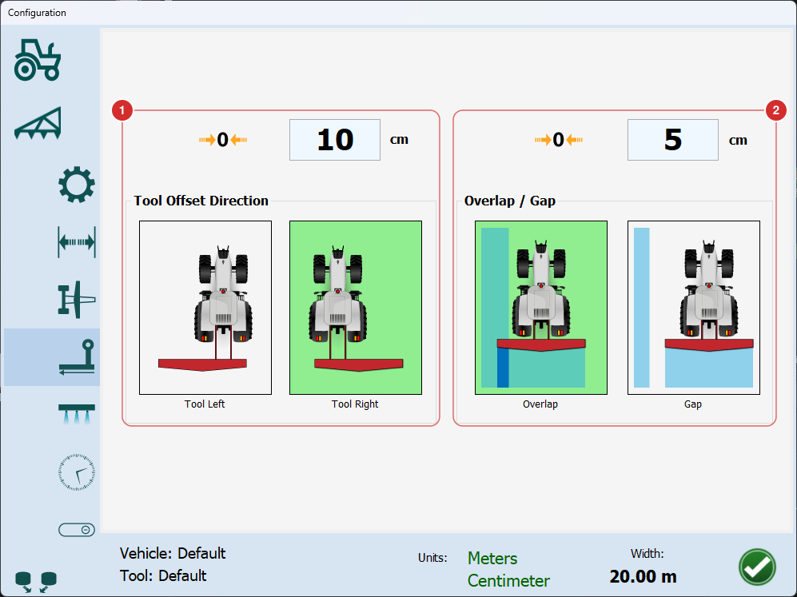

1. **Tool Offset** – How far the tool is to the side of the vehicle's centre
   line. Enter the distance, then tap **Tool Left** or **Tool Right**. The arrow
   button sets it to 0.
2. **Overlap / Gap** – How much the passes should overlap, or how big a gap
   should be left between them. Enter the distance, then tap **Overlap** or
   **Gap**. The guidance lines are placed the tool width minus the overlap (or
   plus the gap) apart. The arrow button sets it to 0.

### Sections

AgOpenGPS can split the implement into sections and switch each one on and off
on its own, so no area gets applied twice. There are two layouts: individual
sections and zones.

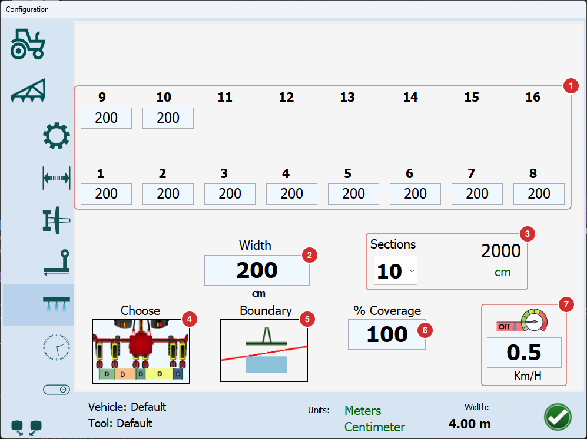

1. **Section widths** – The width of each section. There can be up to 16
   sections.
2. **Width** – The width a section gets when you add sections.
3. **Sections** – The number of sections. The total width of the implement is
   shown next to it.
4. **Choose** – Switches between individual sections and zones.
5. **Boundary** – What happens to a section that is partly outside the field
   boundary. Tap the picture to choose: either the section switches off as soon
   as any part of it is outside, or it stays on as long as any part of it is
   inside.
6. **% Coverage** – How much of a section's area ahead must be unapplied before
   the section switches on. At 100 %, even a small gap switches it on: no
   misses, but more overlap. Lower values accept small gaps to reduce overlap.
7. **Turn-off speed** – Below this speed, all sections switch off.

With zones, up to 64 sections of the same width are grouped into up to 8 zones.
The sections of a zone switch on and off together. Only the top of the page
changes; the other settings work as described above, except that **Width** is
then the width of every section.

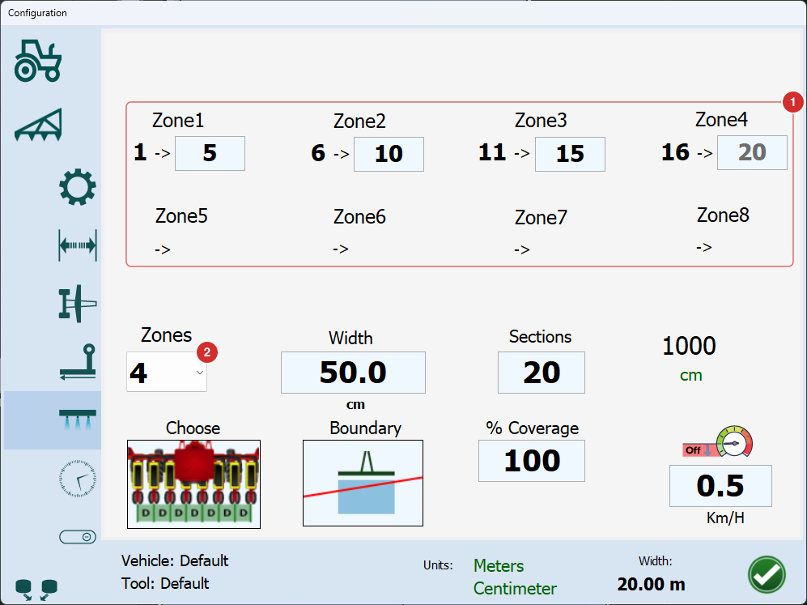

1. **Zone1** to **Zone8** – The sections each zone covers. Enter the last
   section of a zone; the next zone starts with the section after it. The last
   zone always ends with the last section, so its field can't be changed.
2. **Zones** – The number of zones, from 2 to 8.

### Look Ahead

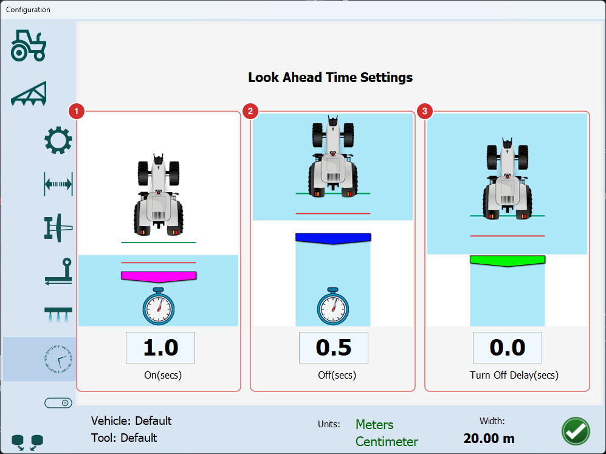

Sections need a moment to react, so AgOpenGPS switches them a little early.
Enter how long your sections take, in seconds:

1. **On** – From switching on until the product reaches the ground.
2. **Off** – From switching off until the product stops. At most 80 % of **On**.
3. **Turn Off Delay** – Keeps a section on for this long after it reaches an
   applied area, instead of switching it off early. Only **Off** or
   **Turn Off Delay** can be set; the other one is then 0.

### Switches

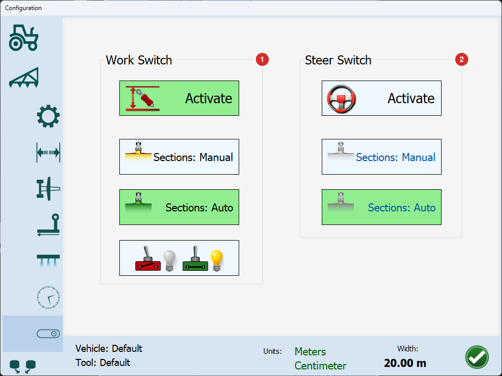

1. **Work Switch** – A switch on the tool, for example on the three-point hitch,
   that tells AgOpenGPS whether the tool is working.
   - **Activate** – Uses the work switch. The other buttons only work when this
     is on.
   - **Sections: Manual** or **Sections: Auto** – Whether the switch turns the
     sections on in manual or in automatic mode.
   - The bottom button chooses whether the tool is working when the switch is
     closed (the input is connected to ground, see the
     [pinout](/hardware/boards/all-in-one-boards/pinout/)) or when it is open.
     The switch next to the lit bulb shows which; in the screenshot, it's
     closed.
2. **Steer Switch** – Lets the steer switch control the sections as well.
   - **Activate** – Uses the steer switch. Here too, the other buttons only
     work when this is on.
   - **Sections: Manual** or **Sections: Auto** – As for the work switch.

## Data Sources

### Heading

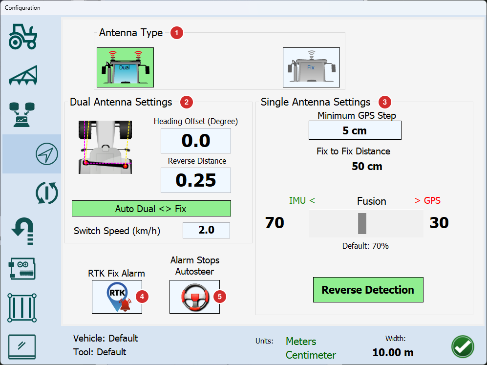

1. **Antenna Type**:
   - **Dual** – Two antennas, which measure the heading directly.
   - **Fix** – One antenna. AgOpenGPS calculates the heading from the movement
     between positions, so it only knows the heading once you're moving. With
     an IMU, the IMU's heading is used and constantly corrected by the
     movement (see **Fusion** below).
2. **Dual Antenna Settings** – Only with **Dual**:
   - **Heading Offset** – Corrects the heading in degrees if the two antennas
     aren't exactly at right angles to the direction of travel.
   - **Reverse Distance** – How far the tractor has to move backwards before
     AgOpenGPS detects that it's reversing.
   - **Auto Dual <> Fix** – When switched on, AgOpenGPS changes how it gets
     the heading depending on the speed. Below the **Switch Speed**, it uses the
     heading from the two antennas. Above it, it works as with **Fix**, with the
     two antennas taking the place of an IMU. **Fix** can't be selected while
     this is on.
   - **Switch Speed** – The speed at which **Auto Dual <> Fix** changes over.
3. **Single Antenna Settings** – With **Fix**, or with **Dual** when
   **Auto Dual <> Fix** is on:
   - **Minimum GPS Step** – Smaller changes of position are ignored, so the
     heading doesn't jump around at low speed or while standing still.
   - **Fix to Fix Distance** – How far the tractor moves between the two
     positions used to calculate the heading.
   - **Fusion** – How much of the heading comes from the IMU and how much from
     the GNSS positions. Only available when an IMU sends data, or when
     **Auto Dual <> Fix** is on.
   - **Reverse Detection** – Lets AgOpenGPS detect when the tractor is
     reversing.
4. **RTK Fix Alarm** – Warns you when the RTK fix is lost.
5. **Alarm Stops Autosteer** – Also switches autosteer off when the RTK fix is
   lost.

### Roll

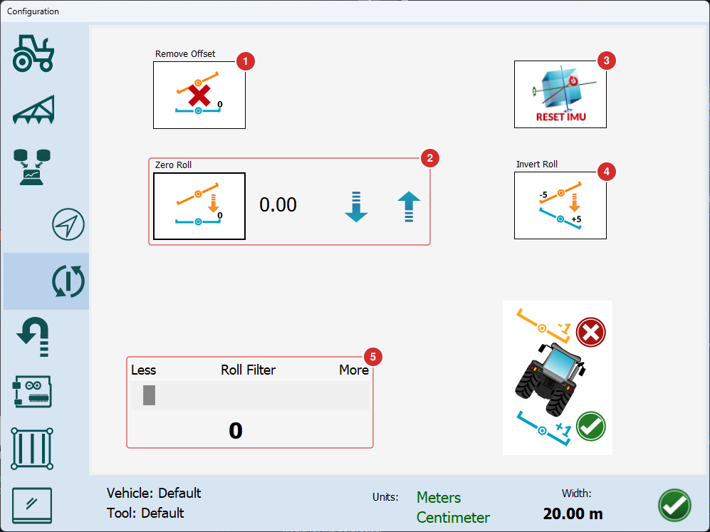

An IMU measures how much the vehicle leans to the side (roll). With the
[antenna height](#antenna), AgOpenGPS uses this to correct the position: on a
slope, the antenna on the roof is further to the side than the wheels.

1. **Remove Offset** – Sets the roll zero back to 0.
2. **Zero Roll** – Park the vehicle on level ground and tap the button: the
   current roll becomes zero. The arrows fine-tune it in steps of 0.1°. If no
   IMU data comes in, the value shows `***`.
3. **Reset IMU** – Discards the IMU values until new data comes in.
4. **Invert Roll** – Reverses the direction of the roll. The picture at the
   bottom right shows which way it must be positive.
5. **Roll Filter** – How much the roll values are smoothed. More filtering
   gives a steadier value that reacts more slowly.

## U-Turn

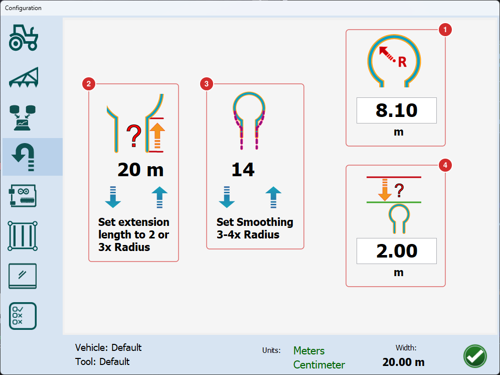

1. **Turn radius** – The radius you can comfortably drive, without the tool,
   drawbar or power take-off (PTO) shaft binding.
2. **Extension length** – How long the straight parts before and after the turn
   are. Change it with the arrows. The app recommends 2 to 3 times the turn
   radius.
3. **Smoothing** – How much the path of the turn is smoothed. Change it with
   the arrows. The app recommends 3 to 4 times the turn radius.
4. **Distance from boundary** – How far from the boundary the turn stays.

## Machine Module

These settings are for the machine module, which switches the sections and the
hydraulic lift. **Changes on these two pages are only saved when you tap
Send + Save.**

### Hydraulic Lift

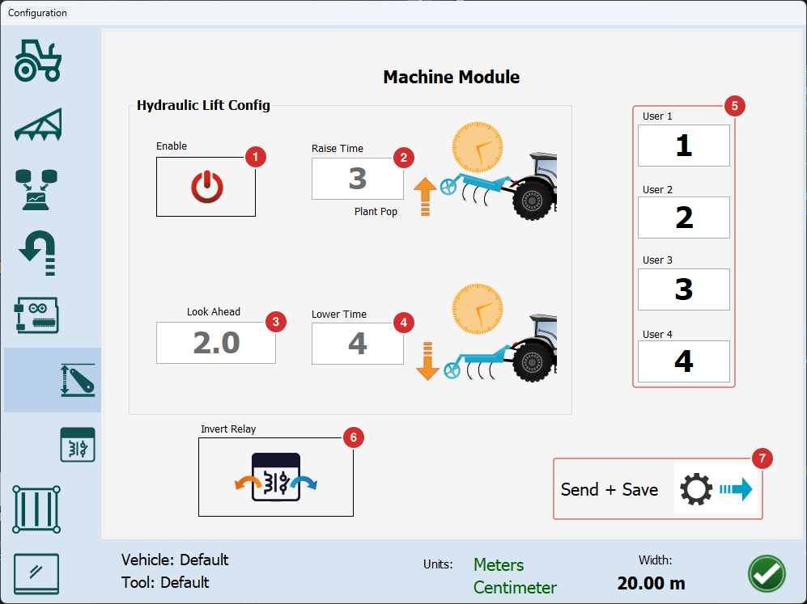

1. **Enable** – Lets AgOpenGPS raise and lower the tool with the hydraulic lift,
   for example at the headland.
2. **Raise Time** – How many seconds the module keeps raising.
3. **Look Ahead** – How many seconds in advance the lift is operated.
4. **Lower Time** – How many seconds the module keeps lowering.
5. **User 1** to **User 4** – Whole numbers from 0 to 255 that are sent to the
   module. The standard firmware doesn't use them; they're meant for your own
   changes to the firmware.
6. **Invert Relay** – Reverses the relay outputs (on becomes off).
7. **Send + Save** – Saves the settings and sends them to the machine module.

### Pins

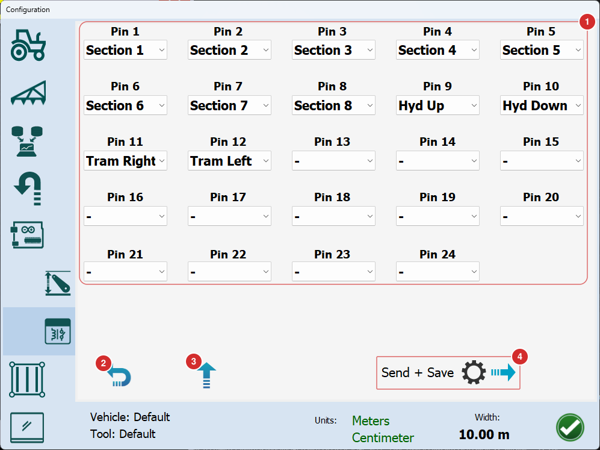

1. **Pin 1** to **Pin 24** – What each output of the machine module does: a
   section (1 to 16), the hydraulic lift (up or down), the tram lines (right or
   left) or Geo Stop. `-` means the pin isn't used.
2. **Reset** – Sets all pins to `-`.
3. **Default** – Sets pins 1 to 3 to sections 1 to 3, all others to `-`.
4. **Send + Save** – Saves the pins and sends them to the machine module.

## Tram Lines

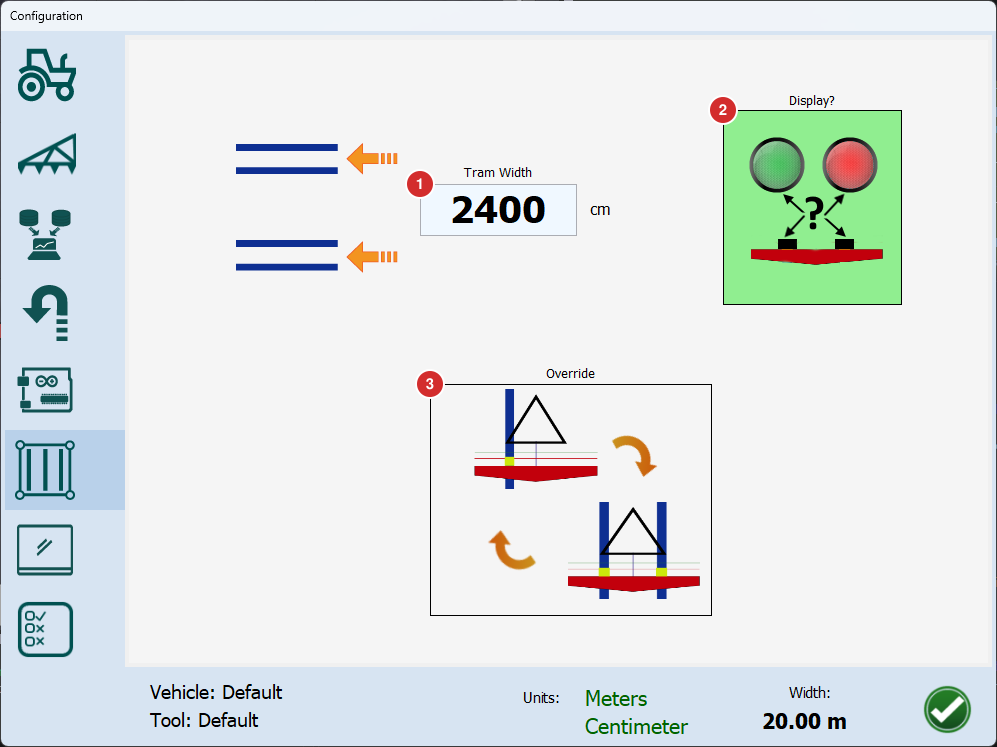

1. **Tram Width** – The distance between the tram lines, usually the width of
   your sprayer.
2. **Display?** – Shows the tram line markers on the tool on the main screen.
3. **Override** – AgOpenGPS works out on which side of the tool the tram lines
   are from the tram width and the tool width. If that's wrong, tap to swap.

## Display

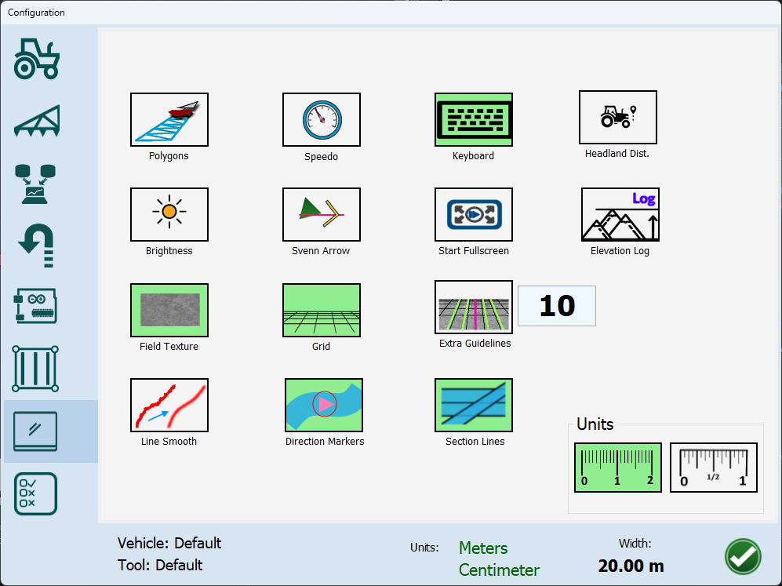

Tap a button to switch an option on or off:

- **Polygons** – Draws the applied area as outlines instead of filled areas.
- **Speedo** – Shows a speedometer.
- **Keyboard** – Shows an on-screen keyboard for text fields.
- **Headland Dist.** – Shows the distance to the headland and sounds a warning
  when you get close to it.
- **Brightness** – Lets AgOpenGPS control the screen brightness.
- **Svenn Arrow** – Shows an arrow in front of the vehicle that points in the
  direction of travel.
- **Start Fullscreen** – Starts AgOpenGPS in full screen.
- **Elevation Log** – Records the elevation to a file in the field folder.
- **Field Texture** – Shows a texture on the field area.
- **Grid** – Shows a grid.
- **Extra Guidelines** – Shows guidance lines next to the current one; the
  number sets how many.
- **Line Smooth** – Draws lines with smoothed edges.
- **Direction Markers** – Shows the direction of travel on the applied area.
- **Section Lines** – Shows lines between the sections on the applied area.
- **Units** – Metric or imperial.

## Features

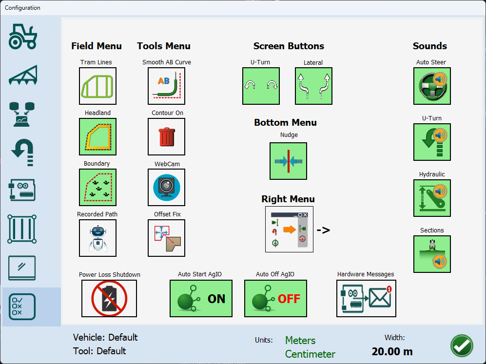

Switches parts of the app on or off, to keep the screen tidy:

- **Field Menu**, **Tools Menu**, **Screen Buttons** and **Bottom Menu** – Shows
  or hides these entries and buttons.
- **Right Menu** – Opens a dialog to choose and arrange the buttons on the right
  of the main screen.
- **Sounds** – Plays a sound:
  - **Auto Steer** – When autosteer switches on or off.
  - **U-Turn** – About 20 m before a U-turn starts, and when a U-turn can't be
    created.
  - **Hydraulic** – When the hydraulic lift goes up or down.
  - **Sections** – When you tap the **Manual** or **Auto** section button.
- **Power Loss Shutdown** – Closes AgOpenGPS when the computer loses external
  power.
- **Auto Start AgIO** – Starts AgIO together with AgOpenGPS.
- **Auto Off AgIO** – Closes AgIO when AgOpenGPS closes.
- **Hardware Messages** – Shows messages that the modules send on the main
  screen.
