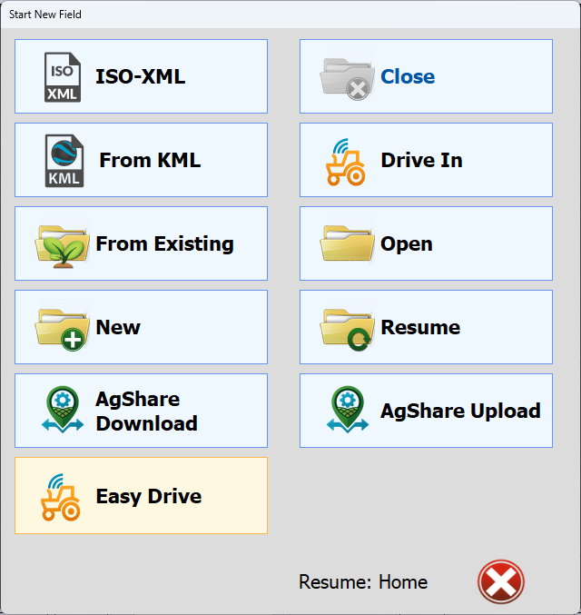
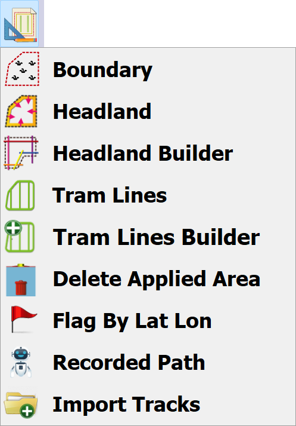
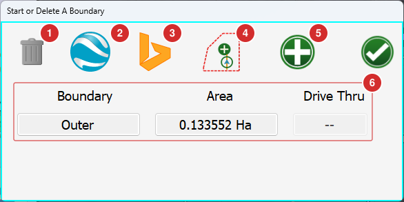
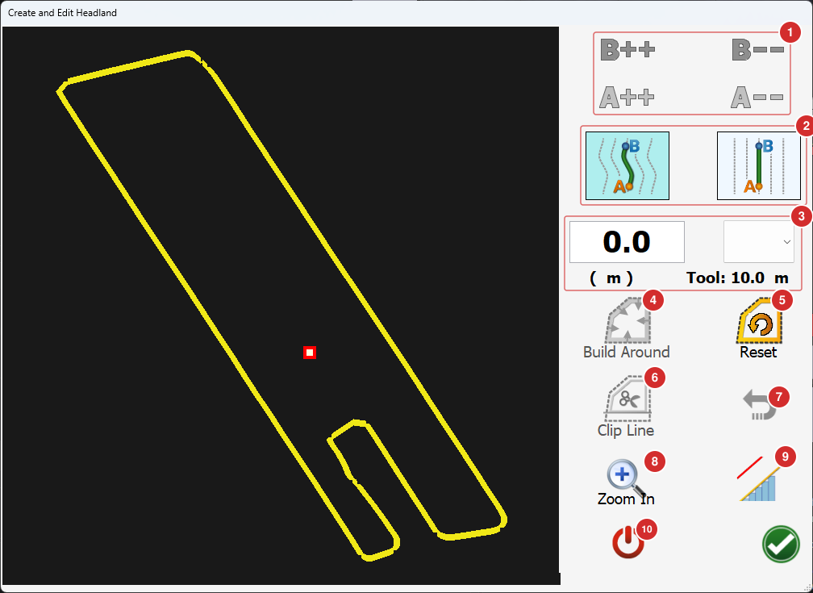
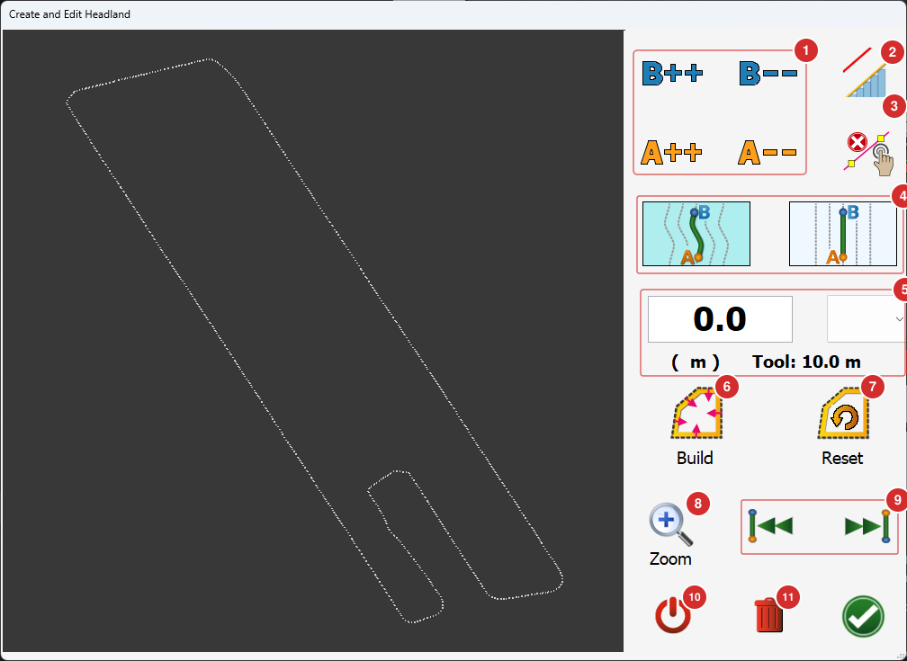
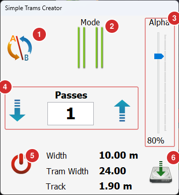
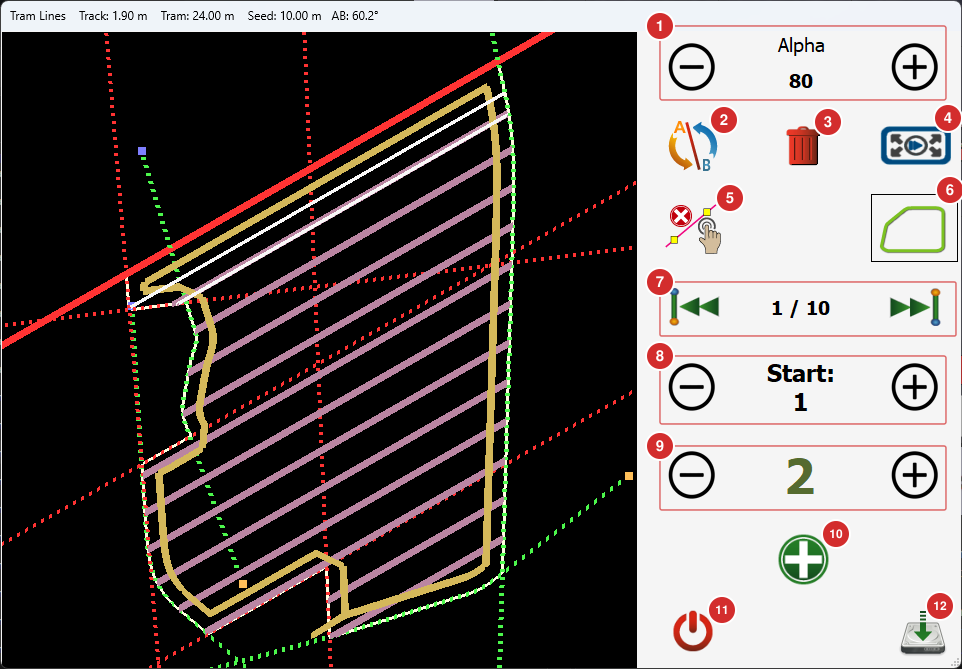
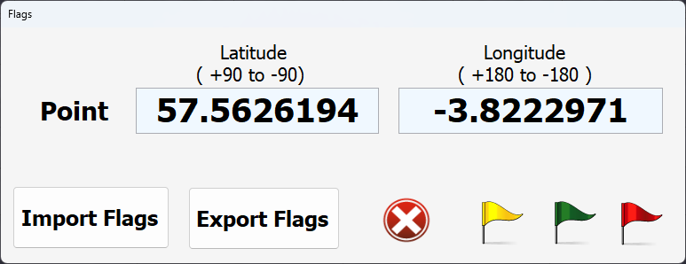
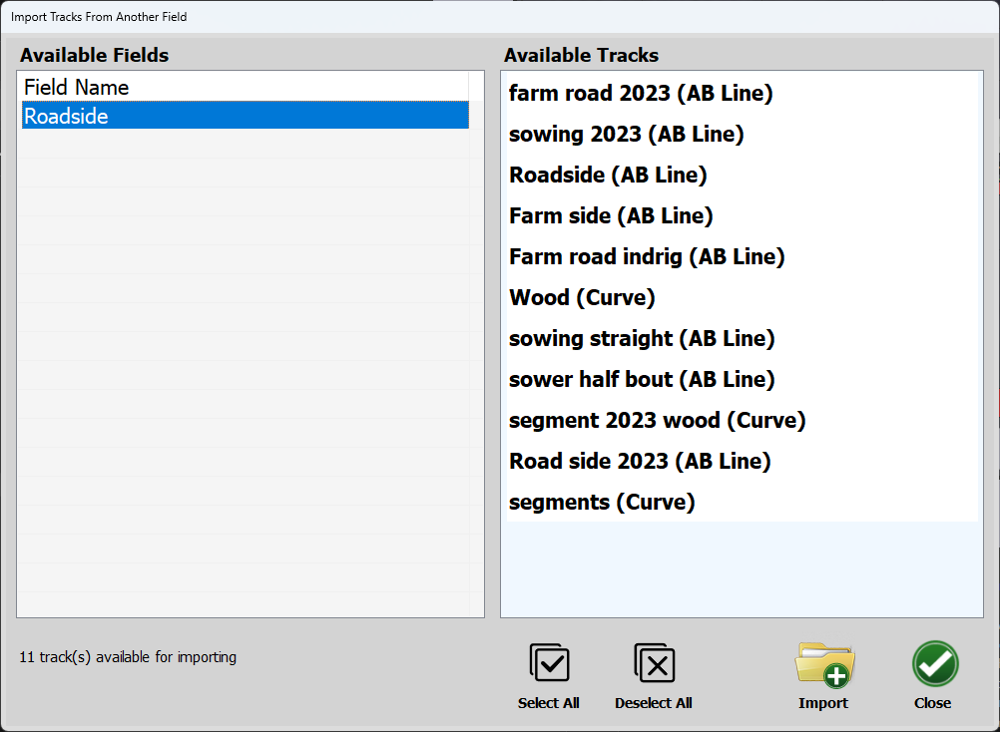

Two buttons on the left of the
[main screen](/software/agopengps-orientation/) are about fields: the
**Field Menu** button starts or opens a field, the **field tools** button
creates boundaries, headlands and more for the open field.

_Screenshots from AgOpenGPS 6.8.6._

## Field Menu Button

- **ISO-XML** – Creates a field from an ISO-XML file.
- **From KML** – Creates a field from a KML file, for example a boundary drawn
  in Google Earth.
- **From Existing** – Creates a new field from an existing one.
- **New** – Creates a new, empty field.
- **AgShare Download** and **AgShare Upload** – Download fields from or upload
  them to [AgShare](https://agshare.agopengps.com/). Only shown when AgShare is
  switched on (see
  [Main Menu](/software/agopengps-orientation/#main-menu)).
- **Easy Drive** – A quick start without a field: enter the working width and
  the hitch length, then create an AB line or curve. Nothing is saved. Only
  possible with no field open.
- **Close** – Saves and closes the open field.
- **Drive In** – Opens the saved field you're in. If there are several, you
  choose one.
- **Open** – Opens a saved field from a list.
- **Resume** – Opens the last field again. Its name is shown at the bottom.

## Field Tools

Only available with a field open.

- **Boundary** – See [Boundary](#boundary).
- **Headland** and **Headland Builder** – See [Headland](#headland). Both need
  a boundary first.
- **Tram Lines** and **Tram Lines Builder** – See [Tram Lines](#tram-lines).
- **Delete Applied Area** – Deletes the applied area and the contour paths of
  the field, after asking you to confirm. Only possible while the sections are
  off.
- **Flag By Lat Lon** – See [Flag By Lat Lon](#flag-by-lat-lon).
- **Recorded Path** – See [Recorded Path](#recorded-path).
- **Import Tracks** – See [Import Tracks](#import-tracks).

**Tram Lines**, **Tram Lines Builder** and **Recorded Path** are hidden at
first. Switch them on in the
[Configuration](/software/agopengps-orientation/configuration/) window, under
Features.

### Boundary

1. **Delete** – Deletes the selected boundary, after asking you to confirm.
2. **Google Earth** – Opens your current position in Google Earth, where you
   can draw a boundary and load it with **Add**.
3. **Bing Maps** – Opens a satellite map from Bing Maps, where you can draw a
   boundary by tapping points. The map can also be shown as the background of
   the field.
4. **From tracks** – Builds a boundary from the field's guidance lines. If the
   field already has a boundary, it asks before replacing it.
5. **Add** – Adds a boundary: either drive around the field, or load it from a
   KML file.
6. **Boundaries** – The field's boundaries, with their area. The first is the
   outer boundary, the others are inner boundaries, for example around a pond.
   Tap one to select it. **Drive Thru** sets whether you can drive through an
   inner boundary.

### Headland

The headland is the strip along the boundary where you turn. AgOpenGPS can use
it for U-turns and to switch the sections off. There are two ways to create
it.

**Headland** builds the headland at a set distance from the boundary, and lets
you cut it straight with lines:

1. **A++**, **A--**, **B++** and **B--** – Make the line longer or shorter at
   either end.
2. **Curve** or **Line** – Whether a line follows the boundary or is straight.
3. **Distance** – How far the headland is from the boundary. The list next to
   it sets the distance as a number of tool widths.
4. **Build Around** – Builds the headland all around the boundary, at the
   distance you set.
5. **Reset** – Starts over.
6. **Clip Line** – Tap two points on the boundary to make a line, then tap
   **Clip Line** to cut the headland along it.
7. **Undo** – Undoes the last cut.
8. **Zoom In** – Tap it, then tap the map to zoom in on that spot.
9. **Section control** – Switches the sections off in the headland.
10. **Off** – Deletes the headland and closes the window.

**Headland Builder** builds the headland from lines, one for each side of the
field:

1. **A++**, **A--**, **B++** and **B--** – Make the selected line longer or
   shorter at either end.
2. **Section control** – Switches the sections off in the headland.
3. **Clear selection** – Unselects the points you tapped.
4. **Curve** or **Line** – Whether a line follows the boundary or is straight.
5. **Distance** – How far the line is from the boundary. The list next to it
   sets the distance as a number of tool widths.
6. **Build** – Joins the lines into a headland. All lines must cross each
   other at their ends, and only once.
7. **Reset** – Deletes the headland.
8. **Zoom** – Tap it, then tap the map to zoom in on that spot.
9. **Previous** and **next line** – Selects the line to edit.
10. **Off** – Deletes the headland and closes the window.
11. **Delete line** – Deletes the selected line.

To make a line, tap two points on the boundary.

### Tram Lines

Tram lines are the tracks you leave free in a crop, for example for the sprayer.
AgOpenGPS can show them and switch tram line outputs on the
[machine module](/software/agopengps-orientation/configuration/). Both windows
need a guidance line; **Tram Lines Builder** also needs a boundary.

**Tram Lines** creates tram lines along the current guidance line:

1. **A/B** – Swaps the direction of the guidance line, which moves the tram
   lines to the other side.
2. **Mode** – Tram lines only, around the boundary only, or both.
3. **Alpha** – How see-through the tram lines are on the map.
4. **Passes** – How many tram lines are created, each one tram width further
   from the guidance line.
5. **Off** – Deletes the tram lines and closes the window.
6. **Save** – Saves the tram lines and closes the window.

**Width**, **Tram Width** and **Track** come from the
[Configuration](/software/agopengps-orientation/configuration/): the tool width,
the distance between tram lines and the track width of the vehicle.

**Tram Lines Builder** creates tram lines along any of the field's guidance
lines, and can cut them:

1. **Alpha** – How see-through the tram lines are on the map.
2. **A/B** – Moves the tram lines to the other side of the selected line.
3. **Delete** – Deletes all tram lines.
4. **Full height** – Makes the window as high as the screen.
5. **Clear selection** – Unselects the points you tapped.
6. **Boundary** – Also creates tram lines around the boundary.
7. **Previous** and **next line** – Selects the guidance line to use.
8. **Start** – The pass the tram lines start at.
9. **Passes** – How many tram lines are created.
10. **Add** – Adds the tram lines of the selected line.
11. **Off** – Deletes the tram lines and closes the window.
12. **Save** – Saves the tram lines and closes the window.

To cut tram lines, tap two points on the map to draw a line, then tap the side
to cut away.

### Flag By Lat Lon

- **Latitude** and **Longitude** – Where the flag goes. The current position is
  filled in; tap a field to enter another one.
- **Yellow**, **green** or **red flag** – Sets a flag of that colour at the
  point.
- **Import Flags** and **Export Flags** – Load flags from a file or save them to
  one.
- The red button closes the dialog without setting a flag.

### Recorded Path

Records a path while you drive, and lets autosteer drive it again later. The
buttons appear on the main screen, from top to bottom:

- **Play** – Drives the recorded path with autosteer, or stops it.
- **Resume** – Where driving starts: at the last stop, at the closest point or
  at the beginning. Tap it to switch.
- **REC** – Records a path while you drive. When you stop, AgOpenGPS asks for a
  name.
- **Folder** – Loads a saved path.
- **A/B** – Reverses the direction of the path.

### Import Tracks

Copies guidance lines from another field into the open one. Choose the field on
the left, select the tracks on the right (or use **Select All**), then tap
**Import**.
