## Field Open Main Display

1. Right Side

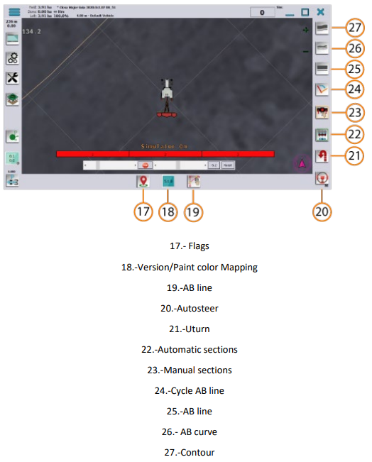

2. Functions for AB Line Selected

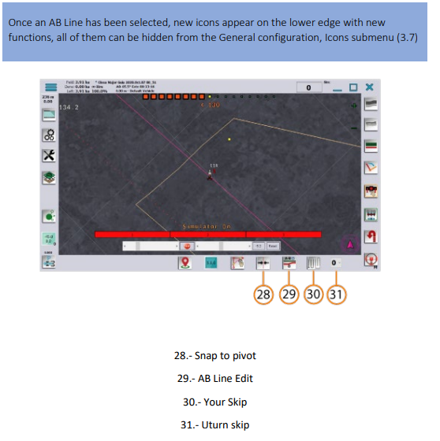

3. Flags

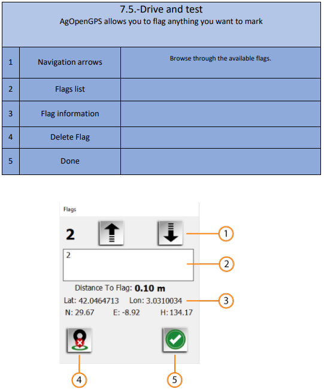

4. Version / Section Paint Color

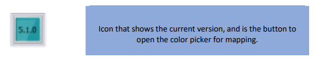

5. Color Setting

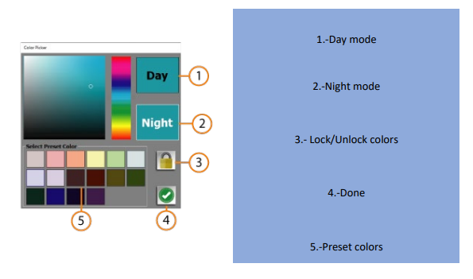

## Guidance Lines

1. AB Line

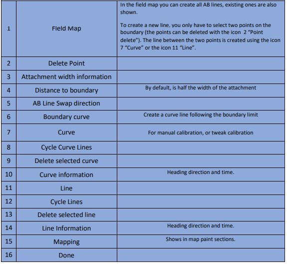

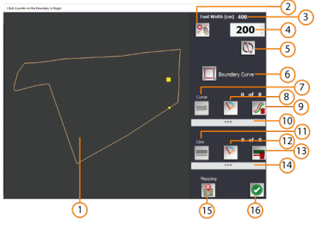

2. Autosteer Control

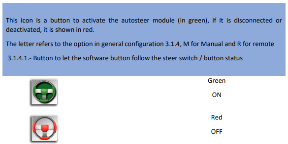

3. U-Turn Control

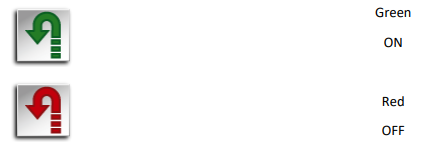

4. Create AB Line or Curve

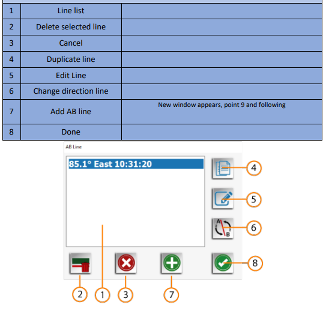

5. Create AB Line

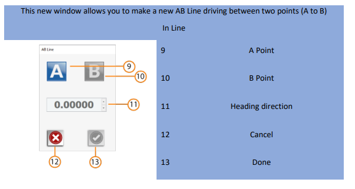

6. Create Curve

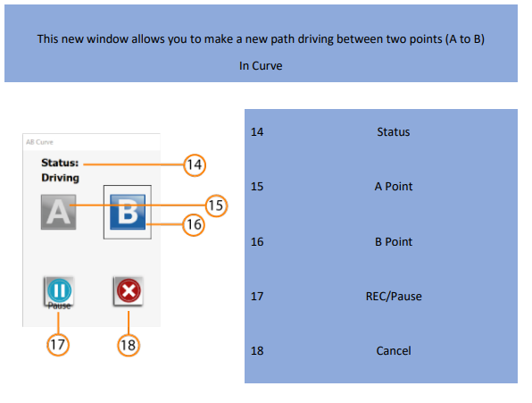

7. Contour

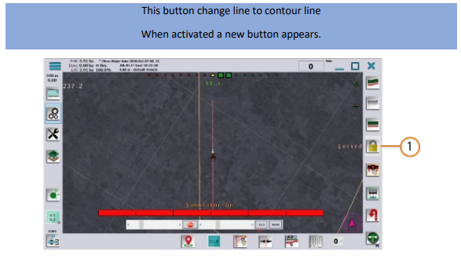

8. Snap to Pivot

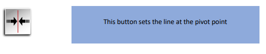

9. AB Line Edit

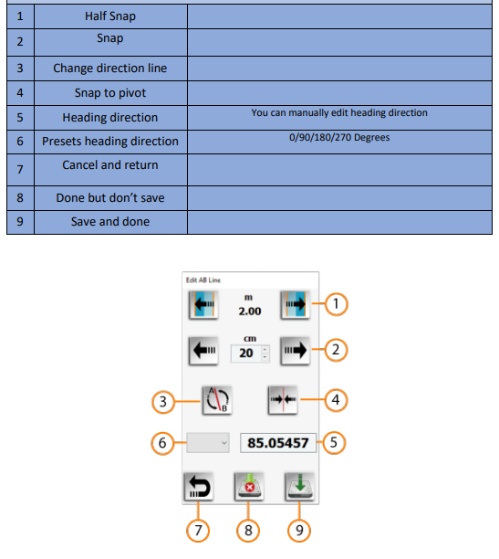

10. U-Turn Skips

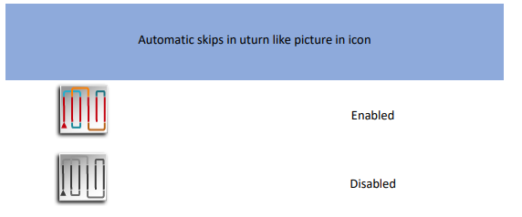

11. Headland Control Buttons

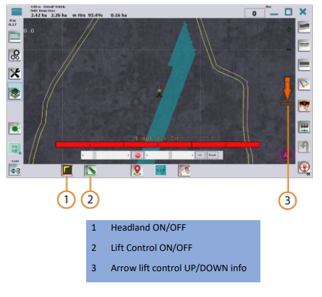
