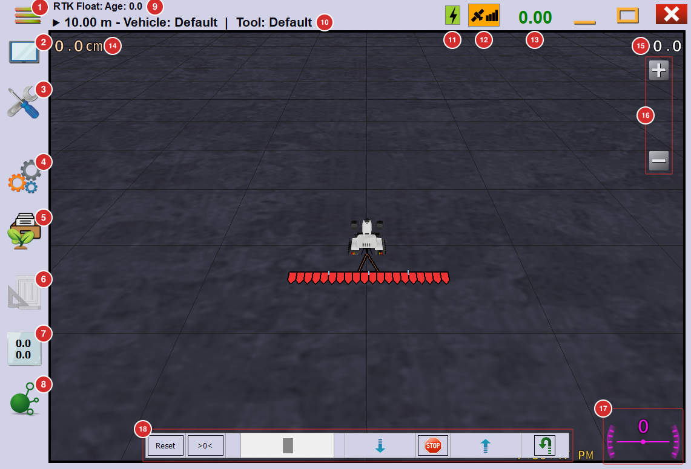
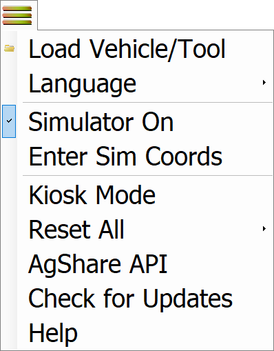
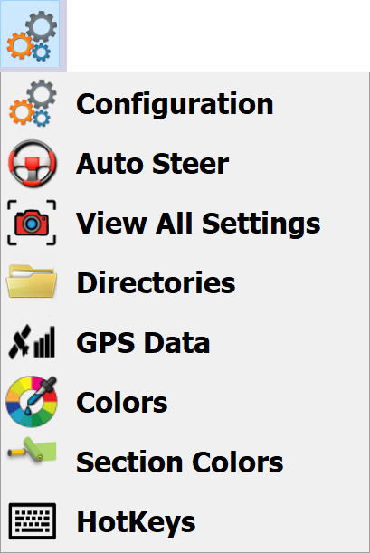
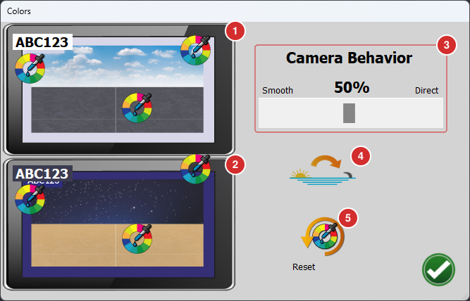
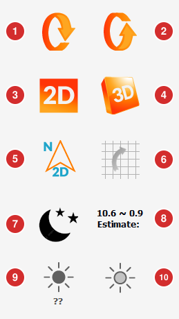

This page explains the main screen of AgOpenGPS. The pages below go through its
menus and settings.

_Screenshots from AgOpenGPS 6.8.6._

## Main Screen

The screenshot shows the main screen with the simulator on and no field open.
With a field open, more buttons appear (see
[Guidance Lines](/software/agopengps-orientation/guidance-lines/)).

1. **Main menu** – See [Main Menu](#main-menu) below.
2. **View options** – Opens the [view options](#view-options).
3. **Utilities** – Wizards, charts and other tools (see
   [Utilities](/software/agopengps-orientation/utilities/)).
4. **Settings** – See [Settings Menu](#settings-menu) below.
5. **Field Menu** – Start a new field or open one (see
   [Field Menu](/software/agopengps-orientation/field-menu/)).
6. **Field tools** – Boundaries, headlands, tram lines and more. Only available
   with a field open.
7. **Auto Steer** – Shows the set and the actual steer angle. Tap it to open
   the steer settings (see [Auto Steer](/software/agopengps-orientation/auto-steer/)).
8. **AgIO** – Starts [AgIO](/software/agio-orientation/), or brings it to the
   front if it's already running.
9. **Fix quality** – The quality of the GNSS position (for example RTK Fix or
   RTK Float) and the age of the correction data.
10. **Info line** – Changes every few seconds between the tool width and the
    loaded profiles, the date and time, and the position. Tap it to pause or
    resume the changes.
11. **Power** – Green when the computer is connected to power, red when it runs
    on battery.
12. **GNSS data** – Shows the GNSS data over the main screen. Tap it again to
    hide it. The colour shows the fix quality: green for RTK Fix, orange for RTK
    Float, yellow for DGPS and red for anything else.
13. **Speed** – The current speed.
14. **GPS step** – How far the position moved since the last one.
15. **Heading** – The direction of travel in degrees.
16. **Zoom** – Zooms in and out.
17. **Roll and steer status** – Shows the roll from the IMU. The colour shows
    the state of autosteer: green when it's on, orange when it's off, red when
    the steer switch is off, and magenta when there's no connection to the steer
    module.
18. **Simulator** – Only shown with the simulator on:
    - **Reset** – Moves the vehicle back to the start position.
    - **>0<** – Sets the steer angle back to straight ahead.
    - The slider sets the steer angle.
    - The blue arrows change the speed; **STOP** sets it to 0.
    - The last button reverses the direction of travel.

## Main Menu

- **Load Vehicle/Tool** – Loads a saved vehicle or tool profile.
- **Language** – The language of AgOpenGPS.
- **Simulator On** – Switches the simulator on or off. Only possible with no
  field open.
- **Enter Sim Coords** – Sets where the simulated vehicle starts.
- **Kiosk Mode** – Keeps AgOpenGPS in full screen and hides the minimize and
  maximize buttons.
- **Reset All** – Resets all settings to their defaults, after asking you to
  confirm. Only possible with no field open. AgOpenGPS then closes, and you
  have to start it again.
- **AgShare API** – Settings for [AgShare](https://agshare.agopengps.com/), to
  share fields online.
- **Check for Updates** – Looks for a new version of AgOpenGPS. Only possible
  with no field open.
- **Help** – Opens the help.

## Settings Menu

- **Configuration** – The vehicle and tool settings (see
  [Configuration](/software/agopengps-orientation/configuration/)).
- **Auto Steer** – The steer settings (see
  [Auto Steer](/software/agopengps-orientation/auto-steer/)).
- **View All Settings** – A list of all settings, with the value in your
  profile and the default. It can also save a screenshot of the list, which is
  useful when you ask for help.
- **Directories** – The folder where AgOpenGPS keeps fields and other data.
  Only possible with no field open.
- **GPS Data** – Shows the GNSS data, like the GNSS data button at the top.
- **Colors** – See [Colors](#colors) below.
- **Section Colors** – The colours of the sections on the map. Only with
  individual sections, not with zones.
- **HotKeys** – Keyboard shortcuts for AgOpenGPS.

### Colors

1. **Day** – The colours in day mode. Tap a colour wheel to change the colour
   of the text (top left), the frame (top right) or the field (middle).
2. **Night** – The same for night mode.
3. **Camera Behavior** – How the view follows the vehicle when it turns: from
   smooth to direct.
4. **Day/night** – Switches between day and night mode.
5. **Reset** – Sets all colours back to their defaults.

## View Options

1. **Tilt down** – Tilts the view down.
2. **Tilt up** – Tilts the view up.
3. **2D** – View from above.
4. **3D** – View from behind the vehicle.
5. **North 2D** – View from above, with north at the top.
6. **Grid** – Rotates the grid to match the field. Only with a field open.
7. **Day/night** – Switches between day and night colours.
8. **Update rate** – Positions per second, the processing time and the fix
   type.
9. **Brightness down** – Also shows the current brightness (`??` if the screen
   doesn't support it).
10. **Brightness up**

If the number of positions per second is constantly below 10, your GNSS
receiver may be set up wrong.
