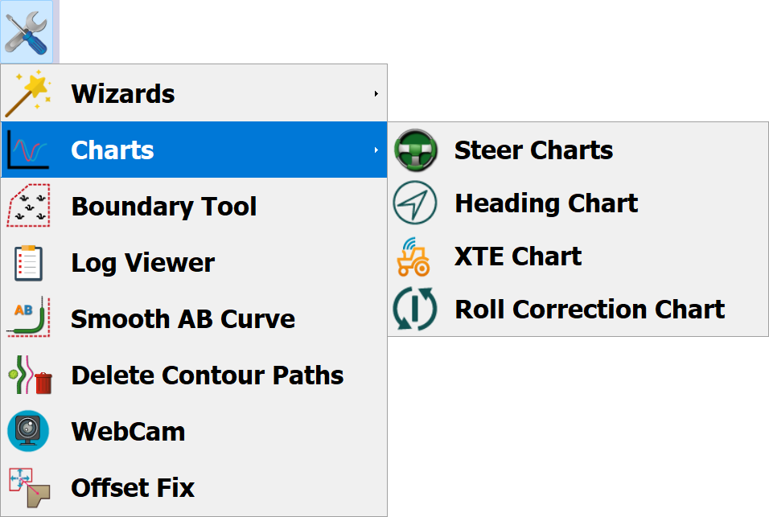
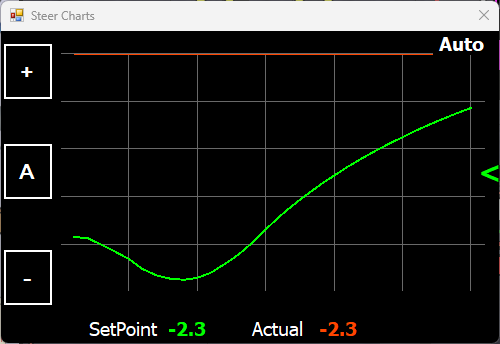
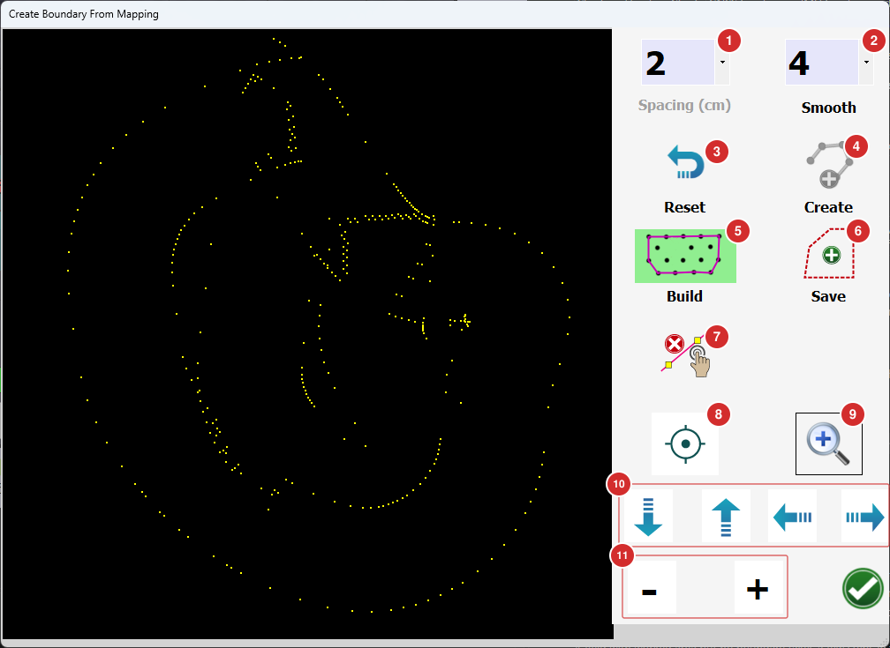
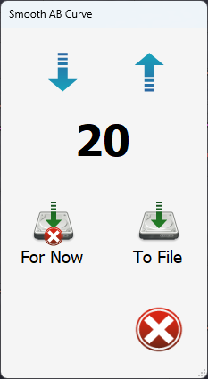
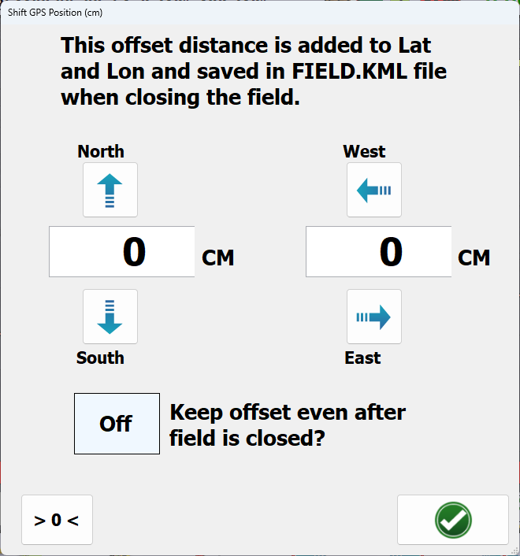

The tools button (the wrench on the left of the
[main screen](/software/agopengps-orientation/)) opens a menu with wizards,
charts and other tools.

_Screenshots from AgOpenGPS 6.8.6._

**Smooth AB Curve**, **Delete Contour Paths**, **WebCam** and **Offset Fix** are
hidden at first. Switch them on in the
[Configuration](/software/agopengps-orientation/configuration/) window, under
Features.

## Wizards

**Steer Wizard** guides you step by step through setting up the steering.

## Charts

Live charts that help when you set up the steering and the sensors.

- **Steer Charts** – The steer angle AgOpenGPS asks for (**SetPoint**, green)
  and the actual steer angle (**Actual**, red). In the simulator, both are the
  same, so the red line is hidden behind the green one.
- **Heading Chart** – The heading from the GNSS positions and from the IMU, and
  the difference between them.
- **XTE Chart** – How far the vehicle is from the guidance line (cross-track
  error) and the heading error.
- **Roll Correction Chart** – How far the roll correction moves the position to
  the side.

**+** and **-** change the scale of the chart; **A** sets it automatically.

## Boundary Tool

Creates a field boundary from the area you've already worked, for example if you
worked a field without a boundary. Only available with a field open.

The yellow dots are the edges of the worked area.

1. **Spacing (cm)** – The distance between the points of the boundary.
2. **Smooth** – How much the boundary is smoothed when you save it.
3. **Reset** – Starts over with the edges of the worked area. **This also
   deletes the field's current boundary and headland.**
4. **Create** – Fills a gap: tap two dots on the map, then tap **Create** to add
   points in a straight line between them.
5. **Build** – Traces a boundary around the dots.
6. **Save** – Saves the boundary as the field boundary. It replaces any boundary
   the field already has.
7. **Clear selection** – Unselects the two dots you tapped for **Create**.
8. **Center** – Shows the whole map again.
9. **Zoom to point** – Tap it, then tap the map to zoom in on that spot.
10. **Move** – Moves the map.
11. **Zoom** – Zooms out and in.

## Log Viewer

Shows the AgOpenGPS event log, a list of what happened and when. Useful when you
look for the cause of a problem or ask for help.

## Smooth AB Curve

Smooths the current curve. Only available with a field open and a curve
selected.

- **Arrows** – Less or more smoothing, from 2 to 100. The main screen shows the
  result.
- **For Now** – Uses the smoothed curve, without saving it.
- **To File** – Uses the smoothed curve and saves it.
- The red button closes the dialog without changing the curve.

## Delete Contour Paths

Deletes the recorded contour paths. **It does so right away, without asking.**

## WebCam

Shows the picture of a connected camera.

## Offset Fix

Moves the position by a few centimetres, for example when your lines no longer
match after your correction source changed.

- **North**/**South** and **West**/**East** – The offset in centimetres. Use the
  arrows or tap the field to enter a value.
- **Keep offset even after field is closed?** – With **Off**, the offset is
  reset when you close the field. As the dialog says, the offset is saved in the
  field's `FIELD.KML` file when you close the field.
- **> 0 <** – Sets both offsets back to 0.
